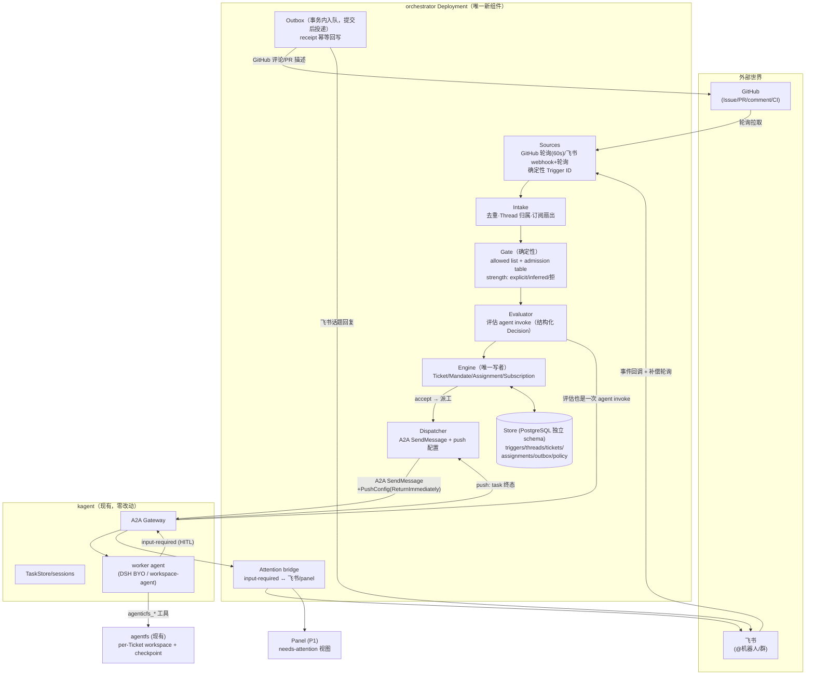
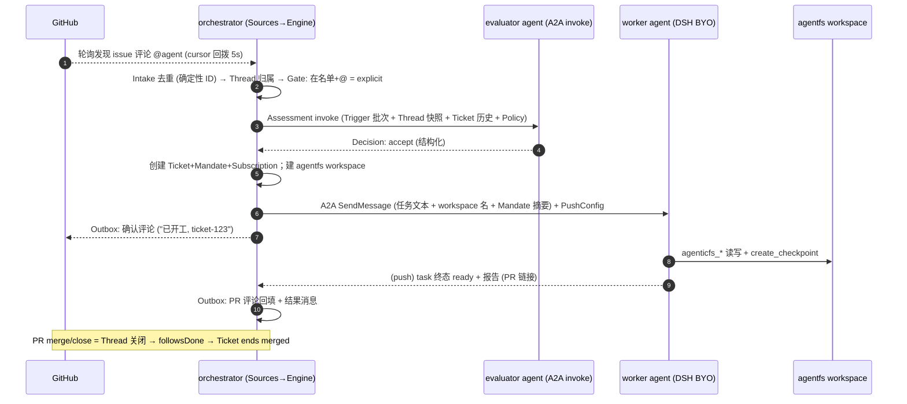
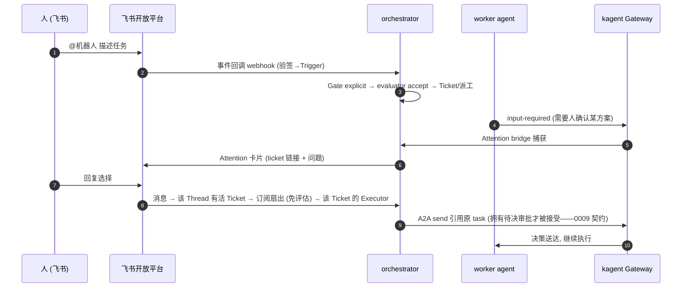
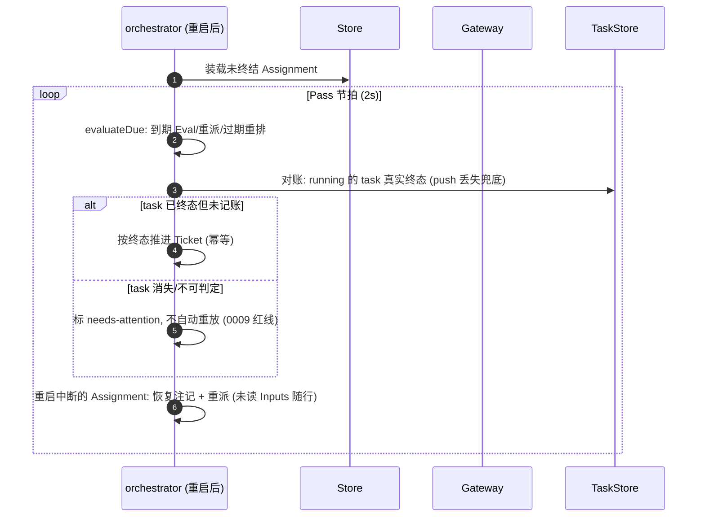

# 0001 — 设计方案：superagent 模式落地 kagent（编排层常驻组件）

> 状态：草案 v1（2026-11-14）。作者：jerry-jibu × ZCode。
> 注记：本文迁自 agent-data-workspace（设计探讨工作区）。文中 `0002`/`0004`/`0005`/`0007`/`0009`/`1001–1007` 等编号指该工作区 `docs/learnings/` 下的学习笔记与 superagent 原型 `docs/00x-*.md`；关键事实已内联为 kagent 仓库的 file:line 引用，本文自洽可读。
> 前置阅读：`0009`（三层长跑模型 + BYO 执行链）、superagent `docs/001-domain.md`/`002-authorization.md`/`007-architecture.md`（领域语义基准）、substrate 系列 1001–1007（算力层事实）。
> 一句话：**superagent 的领域模型照搬（已被验证），执行层换成 kagent 的 A2A task + session + HITL + substrate actor + agentfs workspace；只新建一个编排层进程，不动 agent 运行时。**

---

## 1. 目标与非目标

### 目标

1. **主动型团队 agent**：监听 GitHub（Issue/PR/comment/CI）与飞书（@机器人/群消息），按策略评估后自动开工，结果回到原始会话（评论/PR/群消息），需要人时仅在最少的点上打扰。
2. **复用 kagent 全部已有零件**：session 持久化（TaskStore）、A2A push 回调、HITL（input-required/approval）、substrate 快照算力、agentfs 工作区与快照回滚、DSH BYO harness（0009）。
3. **可审计、可恢复、可授权**：每个触发有确定性 ID 与去向记录；编排器重启不丢工单状态；策略版本化且进 Mandate。

### 非目标（P0 明确不做）

- ❌ 不把编排逻辑塞进 agent 运行时或 substrate（0009 结论：编排层独立进程）。
- ❌ 不新增 kagent CRD（用 ConfigMap + 自有存储起步；若需要声明式接入再议 CRD，见 §10 开放问题）。
- ❌ 不做跨 Source 身份映射（superagent 已拒：那是 prompt 文本，不是实体）。
- ❌ 不做通用 exactly-once 远程执行（不确定结局不自动重放——继承 0009 §4 红线）。

## 2. 总体架构

### 2.1 三层长跑的落位（0009 §7.2 的兑现）

| 层 | 落位 | 常驻性 |
|---|---|---|
| 编排层 | **新建 `orchestrator` Deployment**（本方案全部新代码） | 常驻：Sources 轮询/webhook、Pass 节拍、Engine、Outbox |
| 会话层 | kagent session + A2A task（现有 TaskStore） | 按需：每个 Assignment 一个 task |
| 进程层 | substrate actor（DSH BYO / workspace-agent） | 按需：任务落定即挂起候选（0005） |

### 2.2 组件图

### 2.3 决策点与推荐（本文已按推荐展开，异议再改）

| # | 决策 | 推荐 | 理由 |
|---|---|---|---|
| D1 | Assessment（评估研判）的实现 | **kagent agent invoke**（专用 evaluator Agent CR，结构化输出 Decision） | 白拿 session 持久化/遥测/模型管理/HITL；Engine 仍是唯一写者，评估只是判定输入 |
| D2 | Assignment 完成感知 | **A2A push URL 为主 + TaskStore 查询兜底对账** | `SendMessageConfig{ReturnImmediately:true, PushConfig}` 正是为此设计（0004 §2 三模式）；push 丢失时 Pass 对账 |
| D3 | per-Ticket 工作目录 | **agentfs workspace**（`agenticfs_create_workspace`，零 source 空白沙箱 + checkpoint） | 回滚是免费赠品（0002）；目录名 = ticket ID |
| D4 | worker agent | **DSH BYO agent**（0009）为主，普通 golang-adk agent 为辅 | 编码类任务 DSH 强；两種 harness 经同一 A2A 面，Dispatcher 无感 |
| D5 | Store | **复用集群 PostgreSQL 实例，独立 schema**（substrate 已开此先例，1001 §7） | 一份备份故事；量级是"工单"不是"百万 actor" |
| D6 | 部署位置 | kagent ns（或独立 `orchestrator` ns），Deployment ×1 + PostgreSQL schema + ConfigMap 策略 + Secret（GitHub token/飞书 app） | 与 gateway 同集群零穿透 |

## 3. 对象模型（照搬 superagent 语义 + kagent 映射）

领域概念**原样采用** 001-domain.md 的 Trigger/Thread/Eval/Mandate/Ticket/Assignment/Subscription/Channel 及其规则（含「被拒概念清单」——它们是踩坑记录）。仅做执行层映射：

| superagent 概念 | 本方案的落点 | 归属 |
|---|---|---|
| Source 实例（读位置、bot 身份） | orchestrator 内 Source 插件状态 | Store.sources |
| Trigger（不可变事件+确定性 ID） | 同左，审计与幂等单元 | Store.triggers |
| Thread（GitHub Issue/PR、飞书话题） | 外部会话键 `(source, thread_key)` | Store.threads |
| Eval = Gate + Assessment | Gate 在编排器内（纯代码）；Assessment = evaluator agent 的一次 invoke（结构化 Decision JSON） | 代码 + A2A |
| Decision（accept/stop/ignore/unavailable） | Engine 记录；accept 创建 Ticket | Store.decisions |
| **Mandate**（策略版本+范围+强度+发送者） | 编排器记录；**恢复 ended Ticket 前按当前 Policy 重验** | Store.tickets.mandate |
| **Ticket**（被授权的工作单元） | 编排器记录 + **kagent session**（会话连续性）+ **agentfs workspace**（目录） | 三方：Store.tickets ↔ session_id ↔ workspace_name |
| Assignment（Ticket↔Executor 绑定） | **一个 A2A task**（SendMessage 到 worker agent）；pending→running→ended 跟随 task 生命周期 | Store.assignments.task_id |
| Subscription（Ticket↔Thread 多对多） | 编排器记录；订阅 Thread 上的消息**免评估**直送 Ticket 作上下文 | Store.subscriptions |
| Channel（写侧） | Outbox 的 Channel 适配器：GitHub 评论/review 回复、飞书话题回复 | 代码 |
| Report（progress/waiting/ready/blocked/failed/dropped） | worker agent 的**结构化报告约定**（prompt 约定 + 代码解析；P0 可从 task 终态+文本提取） | Dispatcher/代码 |
| Attention（等人的问题） | worker 的 input-required → Attention bridge → 飞书卡片/panel | ATT 组件 |

**沿用两条关键谓词**（superagent 验证过的状态一致性规则）：`waitsForPerson`（最近 Assignment blocked/failed 且此后无人发言 → 自动输入挂起）；`followupOwners`（还欠人回复的 Ticket 持有 Thread 上的 follow-up，Engine 只许 stop）。

## 4. 关键流程时序

### 4.1 GitHub Issue @agent → 开工 → PR → 收尾

### 4.2 飞书 @机器人 → webhook 直入 + 人工续命

### 4.3 恢复与对账（orchestrator 重启 / push 丢失）

## 5. 与现有系统的对接面（全部已验证存在）

| 对接 | API/机制 | 依据 |
|---|---|---|
| 派工 | A2A `SendMessage`（非流式终态）或 `SendStreamingMessage`（进度） | 0004 §2 |
| 完成回调 | `SendMessageConfig{ReturnImmediately:true, PushConfig{URL,ID}}` → task ID 立即返回，终态 POST 回 orchestrator 的 push endpoint | 0004 三模式表 |
| 人工等待 | kagent HITL：worker 发 `input-required`；回复必须引用原 task 且 task 拥有待决审批（bridge 契约，0009 §4） | 0005/0009 |
| 工作区 | `agenticfs_create_workspace`（零 source 空白沙箱）/`agenticfs_write_file`（intention 必填，审计）/`agenticfs_create_checkpoint`/`agenticfs_rollback_checkpoint` | 0002/0007 |
| 算力 | substrate actor：任务落定即挂起候选；worker 替换后 DATA 恢复（DSH 会话绑定 state.json） | 0005/0009 |
| 凭证 | 编排器持 GitHub token/飞书 app secret（k8s Secret）；**agent 侧零外部凭证**（egress 网关注入模型凭证，0009） | 1006 |
| 策略分发 | ConfigMap（policy 文件 + 各 Source 的 allowed list/admission table/bot list）挂载 orchestrator，版本哈希进 Mandate | 002 授权 |
| 触发 kagent 之外 | 无需——orchestrator 就是 kagent 的"调用方"，与 kagent CLI 同地位 | 0004 §1 |

## 6. Store 与 Outbox（事务纪律）

- **Engine 是唯一写者**（superagent 铁律）：全部状态迁移在单事务内完成；外部副作用（发消息、派工）以 **effect** 在事务内入队、提交后由适配器执行——崩溃重启后 Pass 重放未完成 effect，靠 receipt 幂等。
- **Outbox receipt**：每个外发消息存 receipt（channel, address, 幂等键）；GitHub 评论用确定性 marker、飞书用消息 ID——重复投递可检出。
- **Trigger 幂等**：`(source, deterministic_id)` 唯一约束；cursor 回拨产生的重叠天然去重。
- **TaskStore 对账**：push 是优化不是正确性依赖——Pass 周期把 running Assignment 与 TaskStore 真实终态对账（D2）。

## 7. 安全与授权

1. **门在编排器，不在模型**：allowed list/admission table 是确定性代码；evaluator 只做研判，**无权凭空 accept**（Decision 结构里 accept 必须携带 gate 已判定的 strength + policy 版本，代码校验）。
2. **消息内容是输入不是权限**：提示注入无法提升权限——Mandate 只引用 Policy 版本与发送者身份，不信任任务文本里的任何"授权声明"（002 的原文原则）。
3. **凭证隔离**：编排器持 Source 凭证（写 GitHub/飞书）；worker agent 只有模型凭证（egress 注入）+ agentfs 工作区权限（scope 按 workspace 名单，0007 Grant-by-Paste 语义）。跨 atespace/namespace 复用现有边界。
4. **最小打扰原则**（000-philosophy）：只在 `attention` 与 `result` 两类时刻发消息；progress 默认只在 panel/工单内。

## 8. 失败语义（红线继承）

| 场景 | 行为 |
|---|---|
| worker task 崩溃于远程工具调用中 | 不确定结局 → Assignment 标 `unresolved`，**不自动重放**；Ticket 进 needs-attention，人决策后续（重试=新 Assignment，但被扣住的调用是否已生效由人核） |
| orchestrator 崩溃 | Store 事务已提交的状态无损；启动恢复：中断 Assignment 重派（带恢复注记+未读 Inputs）；已发未确认消息靠 receipt 去重 |
| push 丢失 | Pass 对账兜底（D2）；终态以 TaskStore 为准 |
| Policy 收紧 | 不撤销已授 Mandate、不杀进行中工单；变更记入 Ticket，ended Ticket 恢复前重验（002 语义） |
| agent 长挂 | worker 侧 substrate 快照/挂起是常态（0005）；编排器只看 task 状态，不管理进程 |
| 审批丢失（actor 被替换） | 沿用 bridge 显式失败语义（0009 §4：非活任务引用被拒），编排器转 needs-attention |

## 9. 分期落地

| 期 | 内容 | 完成判据 |
|---|---|---|
| **P0（单仓库单 agent）** | Engine/Store/Outbox + GitHub Source（轮询）+ Gate（名单+admission 表）+ evaluator Agent CR（结构化 Decision）+ Dispatcher（A2A+push）+ GitHub 评论回写 + worker=workspace-agent + agentfs workspace per ticket | 一个 issue 请求全自动开工→PR→评论收尾；orchestrator kill -9 后重启恢复不重不漏 |
| **P1（飞书 + 等人）** | 飞书 Source（webhook+补偿轮询）+ Attention bridge（input-required→飞书卡片→回复回注）+ 人工续命/停止/重试 + 策略热更新（版本化）+ Panel（needs-attention 视图） | blocked 工单在飞书被回答后续跑；stop/retry 全链 |
| **P2（规模与韧性）** | 多仓库/多 Source 实例 + evaluator 批量研判（batch 降本）+ 对账强化（TaskStore 差异扫描）+ 指标（OTel registry 规范）+ 可选 CRD 化接入 | 两仓库并行不串扰；评估成本可见 |

**工作量预估**：P0 核心代码量 ≈ superagent Engine 部分的 Go 重写（其 Engine≈2–3k 行 TS）+ 适配层；最大风险是 Report 结构化约定的打磨（自由文本→六态），P0 先用"终态+文本约定"，P1 再硬化。

## 10. 开放问题

1. evaluator 的成本与延迟：每 Trigger 一次 invoke，风暴时（PR 上 50 条评论）是否够快？——备选：同 Thread 触发合并成批次（superagent 的 Eval batch 语义已定义）。
2. 跨 Source 的"同一件事"识别（issue 与其 PR）：Correlation 只加上下文不路由（001 已拒路由）——落在 prompt 还是结构化引用？
3. 编排器自身的 HA：P0 单副本（锁 + Store 事务保证不重不漏，停机窗口可接受）；P2 是否需要双副本选主？
4. Report 结构化的强制层级：prompt 约定 vs A2A 扩展字段 vs agent 内置工具上报——建议 P0 prompt 约定起步，P2 讨论进 harness 契约（与 byo-ext 生态对齐）。
5. 飞书 webhook 的验签与重放防护细节（开放平台回调规范）。

## 11. 与学习系列的锚点

| 本方案引用 | 出处 |
|---|---|
| 三层长跑模型 | `0009 §7` |
| A2A 三模式/push/HITL | `0004 §2`、`0005` |
| BYO 执行链/审批契约/红线 | `0009 §2–4/8` |
| agentfs workspace/checkpoint/审计 | `0002`、`0007` |
| substrate 算力/DATA/快照 | 1001–1007 系列 |
| superagent 领域语义 | `dsh-superagent-prototype/docs/001/002/003/007`（原型仅参考；本方案的执行层全部换 kagent 实体） |
