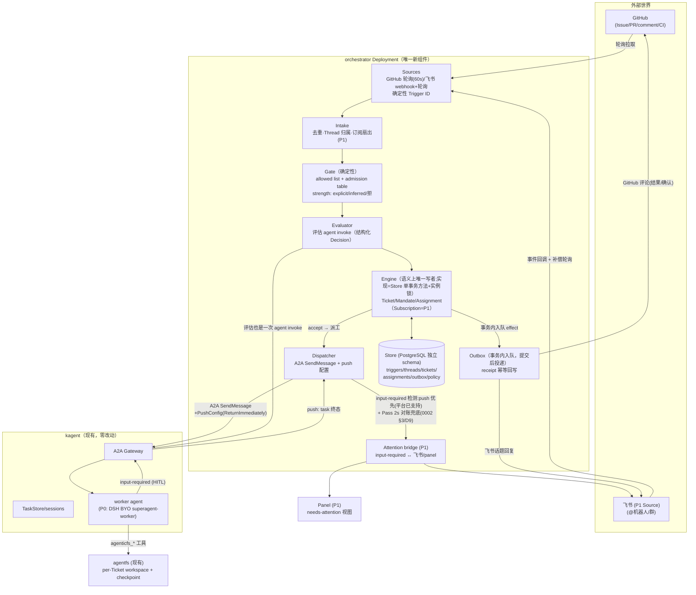
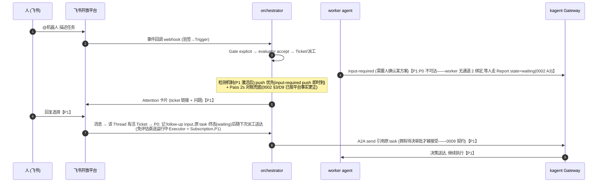
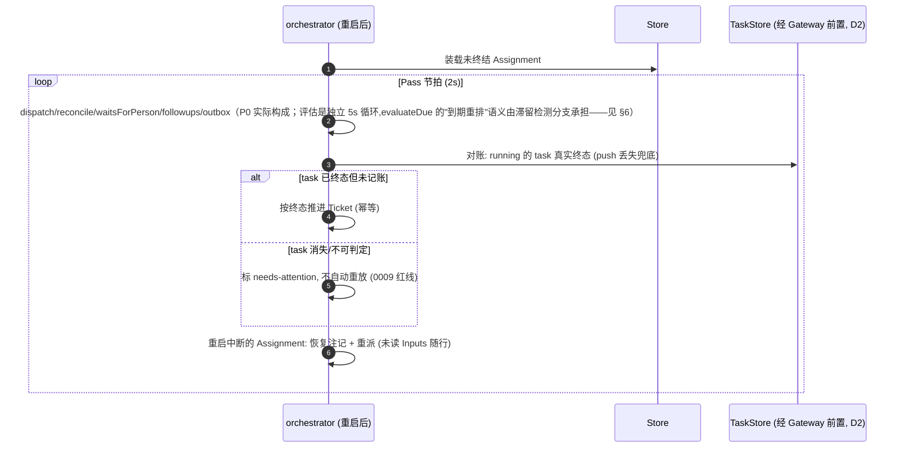

# 0001 — 设计方案：superagent 模式落地 kagent（编排层常驻组件）

> 状态：草案 v2（2026-11-15，经 EGM 评审 4 轮修订：路线/模型配对/审批通道/契约现状/D9 前提等更正已并入，详见各"更正/现状注"块）。作者：jerry-jibu × ZCode。
> 注记：本文迁自 agent-data-workspace（设计探讨工作区）。文中 `0005`/`0007`/`0009`/`1001–1007`/`002`/`001-domain` 等编号指该外部工作区 `docs/learnings/` 下的学习笔记与 superagent 原型 `docs/00x-*.md`，不在本仓库；裸写 `0002`/`0004` 时**按上下文消歧**——引用本目录文档的场合（如 "0002 A3"、"0004 缺口清单"、"见 0002 Alternative E"）指本目录设计文档，其余（如 §5 依据列的 "0002"=外部 agentfs 笔记、"0009" 始终外部）指外部笔记；其被引用的关键结论已按下表内联，本文自洽可读。
> 前置阅读（外部，结论已内联）：`0009`（三层长跑模型 + BYO 执行链）、superagent `docs/001-domain.md`/`002-authorization.md`/`007-architecture.md`（领域语义基准）、substrate 系列 1001–1007（算力层事实）。
>
> **外部编号速查（内联结论；0004 之外的全部承重条目，0004 的 A2A 三模式结论已在 §5 依据列就地复述）**：
>
> | 外部编号 | 内联结论 |
> |---|---|
> | 0004 §1/§2 | A2A 三模式/push 语义（§5 派工行就地复述并按平台实现更正：push 于终态**及** input-required/auth-required 触发）；orchestrator 与 kagent CLI 同为调用方（§5 触发行就地复述） |
> | 0009 §4 | 不确定结局不自动重放（orchestrator `pass.go:143-157`：task 不可判定 → unresolved + needs-attention）；对非活任务的审批引用被显式拒绝（Gateway 侧语义，`go/adk/pkg/a2a/hitl.go:578`——P0 编排器无审批路径） |
> | 0009 §7/§7.2 | 三层长跑模型：编排层常驻、会话/进程层按需（见 §2.1 表） |
> | 0009 §1/§6 | DSH BYO 镜像 digest 钉死契约；state.json↔原生日志耦合为已知中危项；MCP 重定向 same-origin |
> | 0005 | substrate actor 挂起/快照语义：任务落定即挂起候选，DATA 恢复现场 |
> | 0007 | agentfs workspace 授权 = Grant-by-Paste（scope 按 workspace 名单） |
> | 002 | 消息内容是输入不是权限（原文原则）；Policy 收紧不撤已授 Mandate |
> | 001-domain | superagent 领域模型：Trigger/Thread/Eval/Mandate/Ticket/Assignment/Subscription/Channel 及被拒概念清单（§3 照搬） |
> | 1006 | egress 编译期白名单注入模型凭证，bridge 沙箱零外部凭证 |
> | 1001 §7 | substrate 复用集群 PostgreSQL 的先例（D5 依据） |
> 一句话：**superagent 的领域模型照搬（已被验证），执行层换成 kagent 的 A2A task + session + HITL + substrate actor + agentfs workspace；只新建一个编排层进程，不动 agent 运行时。**

---

## 1. 目标与非目标

### 1.1 目标

1. **主动型团队 agent**：监听 GitHub（Issue/PR/comment/CI）与飞书（@机器人/群消息），按策略评估后自动开工，结果回到原始会话（评论/PR/群消息），需要人时仅在最少的点上打扰。
2. **复用 kagent 全部已有零件**：session 持久化（TaskStore）、A2A push 回调、HITL（input-required/approval）、substrate 快照算力、agentfs 工作区与快照回滚、DSH BYO harness（0009）。
3. **可审计、可恢复、可授权**：每个触发有确定性 ID 与去向记录；编排器重启不丢工单状态；策略版本化且进 Mandate。

### 1.2 非目标（P0 明确不做）

- ❌ 不把编排逻辑塞进 agent 运行时或 substrate（0009 结论：编排层独立进程）。
- ❌ 不新增 kagent CRD（用 ConfigMap + 自有存储起步；若需要声明式接入再议 CRD，见 §10 开放问题）。
- ❌ 不做跨 Source 身份映射（superagent 已拒：那是 prompt 文本，不是实体）。
- ❌ 不做通用 exactly-once 远程执行（不确定结局不自动重放——继承 0009 §4 红线）。

## 2. 总体架构

### 2.1 三层长跑的落位（0009 §7.2 的兑现）

| 层 | 落位 | 常驻性 |
|---|---|---|
| 编排层 | **新建 `orchestrator` Deployment**（本方案全部新代码） | 常驻：Sources 轮询/webhook、Pass 节拍、Engine、Outbox |
| 会话层 | kagent session + A2A task（现有 TaskStore） | 按需：每个 Assignment 一个 task |
| 进程层 | substrate actor（P0 = DSH BYO `superagent-worker`；原设想的 workspace-agent 未立项） | 按需：任务落定即挂起候选（0005） |

#### 2.1.1 架构不变式：presence/cognition split（渠道分类，G10 = 0004 缺口清单第 10 项）

**Source 永远住编排器（presence 层），worker actor 永远可挂起（cognition 层）**——渠道连接绝不下沉进 actor。渠道按消息送达方式分两族：

| 渠道族 | 例子 | 落位 |
|---|---|---|
| webhook 族（入站 POST 可驱动一切） | GitHub webhook、飞书事件回调、Teams/Google Chat | Source 收 POST，无需常驻连接 |
| socket 族（持久连接，挂起即死） | 飞书长连接、Slack Socket Mode、WhatsApp/Signal/Matrix | 编排器内 Source 插件持常驻连接 |

扩展新渠道 = 编排器加一个 Source 插件，**零架构变化**；绝不造第二个 presence 网关，也绝不让 worker 持 socket。（来源：agent-substrate/always-on-agent 的 presence/cognition split 参考实现 + openclaw monolithic 反例；0004 互证表。）

### 2.2 组件图



### 2.3 决策点与推荐（本文已按推荐展开，异议再改）

| # | 决策 | 推荐 | 备选与否决理由 |
|---|---|---|---|
| D1 | Assessment（评估研判）的实现 | **kagent agent invoke**（专用 evaluator Agent CR，结构化输出 Decision） | 否决备选：编排器内确定性规则评估——0.1 强度以下触发占比高时更便宜，但规则无法判定"值不值得开工"的语义灰区，且复用 invoke 可白拿 session 持久化/遥测/模型管理/HITL；Engine 仍是唯一写者，评估只是判定输入。P2 若成本成为主诉再引入规则前置过滤（0001 §10 问题 1 的批次合并亦可降本） |
| D2 | Assignment 完成感知 | **A2A push URL 为主 + TaskStore 查询兜底对账** | 否决备选：纯轮询 TaskStore——延迟与 ListTasks 成本随 task 数增长；`SendMessageConfig{ReturnImmediately:true, PushConfig}` 正是为此设计（0004 §2 三模式）；push 丢失时 Pass 对账 |
| D3 | per-Ticket 工作目录 | **agentfs workspace**（目录名 = ticket ID + checkpoint） | 否决备选：worker 自管目录（DATA 卷下自由布局）——绕开 agentfs 审计与授权（Grant-by-Paste），且快照回滚失去免费赠品。**内容模型已演进**：初始设想"零 source 空白沙箱"，0003 定案后为**编排器预物化 mandate 仓库浅克隆**（见 0003"我们的方式"与 0003 改道决策记录） |
| D4 | worker agent | **DSH BYO agent**（0009）为主，普通 golang-adk agent 为辅 | 否决备选：仅 kagent harness worker——结构化输出可用，但编码类任务 DSH 强；两种 harness 经同一 A2A 面，Dispatcher 无感。（原文的 workspace-agent 设想未立项，P0 唯一 worker 为 superagent-worker/dsh-byo） |
| D5 | Store | **复用集群 PostgreSQL 实例，独立 schema**（substrate 已开此先例，1001 §7） | 否决备选：独立 PG 实例（StatefulSet 自管）——备份/升级面翻倍；量级是"工单"不是"百万 actor"，一份备份故事足够；隔离由 schema 边界承担 |
| D6 | 部署位置 | kagent ns（或独立 `orchestrator` ns），Deployment ×1 + PostgreSQL schema + ConfigMap 策略 + Secret（GitHub token/飞书 app） | 否决备选：独立 ns 常设——多一套 RBAC/网络策略面；P0 落 kagent ns，与 gateway 同集群零穿透 |

文档级备选（"为什么要一个独立编排器进程"而非包裹 superagent TS 原型本体或把编排塞进 agent 运行时）：见 0002 Alternative E 与本文非目标第 1 条（0009 结论：编排层独立进程）。

## 3. 对象模型（照搬 superagent 语义 + kagent 映射）

领域概念**原样采用** 001-domain.md 的 Trigger/Thread/Eval/Mandate/Ticket/Assignment/Subscription/Channel 及其规则（含「被拒概念清单」——它们是踩坑记录）。仅做执行层映射：

| superagent 概念 | 本方案的落点 | 归属 |
|---|---|---|
| Source 实例（读位置、bot 身份） | orchestrator 内 Source 插件状态 | Store.sources |
| Trigger（不可变事件+确定性 ID） | 同左，审计与幂等单元 | Store.triggers |
| Thread（GitHub Issue/PR、飞书话题） | 外部会话键 `(source, thread_key)` | Store.threads |
| Eval = Gate + Assessment | Gate 在编排器内（纯代码）；Assessment = evaluator agent 的一次 invoke（结构化 Decision JSON） | 代码 + A2A |
| Decision（accept/stop/ignore/unavailable） | Engine 记录；accept 创建 Ticket | Store.decisions |
| **Mandate**（策略版本+范围+强度+发送者） | 编排器记录；"恢复 ended Ticket 前按当前 Policy 重验"——**P0 未实现**（无 ended Ticket 恢复流程，admin retry 仅限 needs-attention；Policy 变更不回写工单），列 P1 | Store.tickets.mandate |
| **Ticket**（被授权的工作单元） | 编排器记录 + **kagent session**（会话连续性）+ **agentfs workspace**（目录）。三方绑定 P0 现状：仅 `session_id` 落库维护；`workspace_name` 列已在 0001_init.sql 预留但暂无代码读写（workspace 身份隐式 = ticket ID），补齐在 P1 | 三方：Store.tickets ↔ session_id ↔ workspace_name |
| Assignment（Ticket↔Executor 绑定） | **一个 A2A task**（SendMessage 到 worker agent）；pending→running→ended 跟随 task 生命周期 | Store.assignments.task_id |
| Subscription（Ticket↔Thread 多对多） | **P0 未实现**（无 subscriptions 表；owned-thread 消息记为 ignore + follow-up input，随下次派工送达，见 `eval/engine.go:121-148`；`Store.subscriptions` 与免评估直送列 P1） | Store.subscriptions（P1） |
| Channel（写侧） | Outbox 的 Channel 适配器：GitHub 评论/review 回复、飞书话题回复 | 代码 |
| Report（progress/waiting/ready/blocked/failed/dropped） | worker agent 的**结构化报告约定**（prompt 约定 + 代码解析）。P0 现状：worker prompt 只教五态（progress/ready/blocked/failed/waiting），`dropped` 仅为编排器解析端终态；"ready 前无在途后台任务"约定（G8）**未写入 P0 prompt**——补 prompt 一行走 PR 代码修复批次，P2 再议信号机制 | Dispatcher/代码 |
| Attention（等人的问题） | worker 的 input-required → Attention bridge → 飞书卡片/panel | ATT 组件 |

**沿用两条关键谓词**（superagent 验证过的状态一致性规则）：`waitsForPerson`（最近 Assignment blocked/failed 且此后无人发言 → 自动输入挂起）；`followupOwners`（还欠人回复的 Ticket 持有 Thread 上的 follow-up，Engine 只许 stop）。

## 4. 关键流程时序

### 4.1 GitHub Issue @agent → 开工 → PR → 收尾

```mermaid
sequenceDiagram
    autonumber
    participant GH as GitHub
    participant O as orchestrator (Sources→Engine)
    participant EV as evaluator agent (A2A invoke)
    participant WA as worker agent (DSH BYO)
    participant AFS as agentfs workspace

    GH-->>O: 轮询发现 issue 评论 @agent (cursor 回拨 5s)
    O->>O: Intake 去重 (确定性 ID) → Thread 归属 → Gate: 在名单+@ = explicit
    O->>EV: Assessment invoke (P0 实现: 单 Trigger + strength + policy_version + decision_schema;批输入/Thread 快照/Ticket 历史为 P2 增强项)
    EV-->>O: Decision: accept (结构化)
    O->>O: 创建 Ticket+Mandate（Subscription P0 未实现）；物化 agentfs workspace（0003: 预置浅克隆）
    O->>WA: A2A SendMessage (任务文本 + workspace 名 + Mandate 摘要) + PushConfig
    O-->>GH: Outbox: 确认评论 ("已开工, ticket-123")
    WA->>AFS: agenticfs_* 读写 + create_checkpoint（worker 无 git，纯文件编辑——0003 实施路线）
    WA-->>O: (push) task 终态 ready + 报告 (state=ready + artifacts 工作区路径)
    O->>O: 读回工作区 → 确定性 commit/push/建 PR + Outbox 结果消息
    Note over GH,O: PR merge/close = Thread 关闭 → followsDone → Ticket ends merged（P0 未实现:仅轮询 issue 评论,无 merge/close 事件,终态仅 ended 无 merged——列 P1）
```

### 4.2 飞书 @机器人 → webhook 直入 + 人工续命



### 4.3 恢复与对账（orchestrator 重启 / push 丢失）



## 5. 与现有系统的对接面（全部已验证存在）

| 对接 | API/机制 | 依据 |
|---|---|---|
| 派工 | A2A `SendMessage`（非流式终态）或 `SendStreamingMessage`（进度） | 0004 §2 |
| 完成回调 | `SendMessageConfig{ReturnImmediately:true, PushConfig{URL,ID}}` → task ID 立即返回；POST 回 orchestrator 的 push endpoint 于**终态及 input-required/auth-required**（`a2a-push-notifications.md:42-44`、`push_delivery.go:47`；编排器 `dispatcher.go:357` 已处理 input-required push） | 0004 三模式表 + 平台实读 |
| 人工等待 | kagent HITL：worker 发 `input-required`；回复必须引用原 task 且 task 拥有待决审批（bridge 契约，0009 §4）。**P0 不可达**（无通道 2 绑定——"等人"走 Report `state=waiting` → needs-attention，0002 A3） | 0005/0009 |
| 工作区 | `agenticfs_create_workspace`（P0 内容模型：编排器预物化 mandate 仓库浅克隆，非零 source 空白沙箱——0003 改道决策）/`agenticfs_write_file`（intention 必填，审计）/`agenticfs_create_checkpoint`/`agenticfs_rollback_checkpoint` | 0002/0007（外部笔记）+ 0003 |
| 算力 | substrate actor：任务落定即挂起候选；worker 替换后 DATA 恢复（DSH 会话绑定 state.json） | 0005/0009 |
| 凭证 | 编排器持 GitHub token/飞书 app secret（k8s Secret）；**agent 侧零外部凭证**（egress 网关注入模型凭证，0009） | 1006 |
| 策略分发 | ConfigMap（policy 文件 + 各 Source 的 allowed list/admission table/bot list）挂载 orchestrator，版本哈希进 Mandate | 002 授权 |
| 触发 kagent 之外 | 无需——orchestrator 就是 kagent 的"调用方"，与 kagent CLI 同地位 | 0004 §1 |

## 6. Store 与 Outbox（事务纪律）

- **Engine 是唯一写者**（superagent 铁律）：全部状态迁移在单事务内完成；外部副作用以 **effect** 在事务内入队、提交后由适配器执行——崩溃重启后 Pass 重放未完成 effect，靠 receipt 幂等。**P0 实际范围**：Outbox effect 承载结果评论；git push 与建 PR 为交付器幂等直调（确定性 commit + 同 head 分支复用），非 effect 入队——已接受的纪律偏离，P1 若引入多通道投递再统一入队。
- **Outbox receipt**：每个外发消息存 receipt（channel, address, 幂等键）；GitHub 评论用确定性 marker、飞书用消息 ID——重复投递可检出。
- **Trigger 幂等**：`(source, deterministic_id)` 唯一约束；cursor 回拨产生的重叠天然去重。
- **Thread 视线（sightline）**：无活 Ticket（pending/running/needs-attention）的 Thread 保留 **14 天视线**；超视线线程的新事件在 intake 丢弃（`DefaultSightline = 14 * 24h`，`intake.go:18-21`）。注意 `failed`/`ended` 均为终态、不计活——"失败线程永不脱离视线"是已知实现缺陷，随 PR 代码修复批次更正。
- **Assignment deadline（G7）**：派发即记 started_deadline（可配窗口）；Pass 对"已派发但超期仍未进入终态"的 Assignment 转 needs-attention——task 受理与执行之间必须有期限、滞留必须有显式释放者，不自动重放。（教训源自 claude-managed-agents lease 模型：ack 后永不心跳的 item 永不回收。）
- **TaskStore 对账**：push 是优化不是正确性依赖——Pass 周期把 running Assignment 与 TaskStore 真实终态对账（D2）。

## 7. 安全与授权

1. **门在编排器，不在模型**：allowed list/admission table 是确定性代码；evaluator 只做研判，**无权凭空 accept**（Decision 结构里 accept 必须携带 gate 已判定的 strength + policy 版本，代码校验）。
2. **消息内容是输入不是权限**：提示注入无法提升权限——Mandate 只引用 Policy 版本与发送者身份，不信任任务文本里的任何"授权声明"（002 的原文原则）。
3. **凭证隔离**：编排器持 Source 凭证（写 GitHub/飞书）；worker agent 只有模型凭证（egress 注入）+ agentfs 工作区权限（scope 按 workspace 名单，0007 Grant-by-Paste 语义）。跨 atespace/namespace 复用现有边界。
4. **最小打扰原则**（外部工作区哲学笔记 000-philosophy 的内联结论）：只在 `attention`、`result` 与**开工确认**三类时刻发消息（开工确认即 §4.1 时序第 7 步的 "已开工" 评论——本条以 §4.1 为准，原"两类时刻"表述已修正）；progress 默认只在 panel/工单内。

## 8. 失败语义（红线继承）

| 场景 | 行为 |
|---|---|
| worker task 崩溃于远程工具调用中 | 不确定结局 → Assignment 标 `unresolved`，**不自动重放**；Ticket 进 needs-attention，人决策后续（重试=新 Assignment，但被扣住的调用是否已生效由人核） |
| orchestrator 崩溃 | Store 事务已提交的状态无损；启动恢复：中断 Assignment 重派（带恢复注记+未读 Inputs）；已发未确认消息靠 receipt 去重 |
| push 丢失 | Pass 对账兜底（D2）；终态以 TaskStore 为准 |
| task 受理后不启动（Gateway 投递丢失/actor 供给失败） | Assignment 超 started_deadline 仍非终态 → needs-attention（G7 滞留检测），不自动重放 |
| Policy 收紧 | 不撤销已授 Mandate、不杀进行中工单；变更记入 Ticket，ended Ticket 恢复前重验（002 语义）。**P0 现状**：前半句成立（收紧不撤不杀）；"变更记入 Ticket/恢复前重验"未实现（见 §3 Mandate 行 P1 注） |
| agent 长挂 | worker 侧 substrate 快照/挂起是常态（0005）；编排器只看 task 状态，不管理进程 |
| 审批丢失（actor 被替换） | 沿用 bridge 显式失败语义（0009 §4：非活任务引用被拒），编排器转 needs-attention |

## 9. 分期落地

| 期 | 内容 | 完成判据 |
|---|---|---|
| **P0（单仓库单 agent）** | Engine/Store/Outbox + GitHub Source（轮询）+ Gate（名单+admission 表）+ evaluator Agent CR（结构化 Decision）+ Dispatcher（A2A+push）+ GitHub 评论回写 + worker=**superagent-worker（dsh-byo）** + agentfs workspace per ticket（0003 预物化模型） | 一个 issue 请求全自动开工→PR→评论收尾（P0 由 `deploy/kagent/e2e-v1.sh` + fake GitHub 面覆盖；真 GitHub 走查为 README 协调者步骤）；orchestrator kill -9 后重启恢复不重不漏（**当前仅有单测覆盖**（`restart_test.go`/`recovery_test.go`），e2e kill/重启步骤随 PR 修复批次补） |
| **P1（飞书 + 等人）** | 飞书 Source（webhook+补偿轮询）+ Attention bridge（input-required→飞书卡片→回复回注）+ Panel（needs-attention 视图）+ ~~人工续命/停止/重试 + 策略热更新（版本化）~~（**已提前落 P0**：admin list/retry/stop HTTP 面与 policy 热更新 watcher 已实现） | blocked 工单在飞书被回答后续跑；stop/retry 全链 |
| **P2（规模与韧性）** | 多仓库/多 Source 实例 + evaluator 批量研判（batch 降本）+ 对账强化（TaskStore 差异扫描）+ 指标（OTel registry 规范）+ 可选 CRD 化接入 | 两仓库并行不串扰；评估成本可见 |

### 9.1 P0 交付物清单（目标文件与包布局）

P0 实际交付为 `orchestrator/` Go 模块（94 个 .go 文件：45 非测试 + 49 测试）+ `deploy/kagent/` 工件（0002 目标清单之外的收编见该文档实现计划节）：

| 包 | 职责 |
|---|---|
| `orchestrator/internal/store` | PostgreSQL 持久层：8 个迁移文件（triggers/threads/tickets/assignments/decisions/audit/outbox…；注：`0002_audit`/`0002_intake` 共用 0002 前缀，排序按文件名字典序——重编号列代码修复批次）、全部状态迁移（单事务、状态+审计原子） |
| `orchestrator/internal/intake` | 触发去重、Thread 归属、14 天视线 |
| `orchestrator/internal/gate` | 纯函数门控（名单 + admission 表 → strength） |
| `orchestrator/internal/eval` | Assessment invoke 与 Decision 落账（独立 5s 循环） |
| `orchestrator/internal/dispatch` | 派发/对账/滞留/等待/续跑（Pass 2s）+ Report 解析 + push 接收器 |
| `orchestrator/internal/a2a` | A2A 客户端（SendMessage + push 配置） |
| `orchestrator/internal/workspace` | clone/物化/读回/patch（0003 实施路线）+ MCP(agentfs) 客户端 |
| `orchestrator/internal/delivery` | 交付器：确定性 commit → push → PR → 结果评论 effect |
| `orchestrator/internal/github` | GitHub 客户端（轮询/评论/PR，422→复用幂等） |
| `orchestrator/internal/outbox` | effect 通道适配（GitHub 评论） |
| `orchestrator/internal/policy` | policy 加载与热更新 watcher（serve-then-deliver） |
| `orchestrator/internal/server` / `source` / `testenv` | admin HTTP / Source 抽象 / PG 测试夹具 |
| `orchestrator/cmd/{orchestrator,fakegithub}` | 入口与 e2e 用 fake GitHub 面 |
| `deploy/kagent/` | orchestrator.yaml、agent-worker/evaluator.yaml、modelconfig×2、harness-dsh-byo、e2e-v1.sh、README |

### 9.2 验证（P0 现状）

- **单测**：13 包全覆盖（含 PG 语义测试，`DATABASE_URL` 驱动、未设时 skip）；given-when-assert-that 风格；restart/recovery/红线重放场景在列。
- **e2e**：`e2e-v1.sh`（V1 场景）真断言 ticket 状态/交付/egress 零出站；kill -9 步骤待补（见上表）。
- **符合性测试**（0002 兼容策略）：waitsForPerson/followupOwners 已各对应单测（`TestPassWaitsForPerson`/`TestWaitsForPersonTickets`/`TestFollowupOwnerOfThread`/`TestEngineFollowupOwners`）；"Engine 唯一写者"不变量无直接单测——其交付形态是 Store 事务方法 + 实例 advisory lock（`store.go:321-346` `TryAcquireInstanceLock`；inbox 级另有 `pg_try_advisory_xact_lock` 去重锁），写路径分布在 eval/dispatch/delivery/admin/intake（见 §9.1），组件级单写者断言在当前布局下不成立，语义由"全部迁移经 Store 单事务执行"保障。
- **场景覆盖**：V1 已覆盖；V6 仅 2000×24KiB≈47MiB 小规模夹具断言、未在目标规模验证且生产无强制上限（见 0003 V6 现状注）；V2/V3/V4/V5 均未执行（0003 各场景已带状态标注：V4/V5 前提被通道能力否定，V2 未排期随恢复项补、V3 随多 agent 工单排期补）。

## 10. 开放问题

1. evaluator 的成本与延迟：每 Trigger 一次 invoke，风暴时（PR 上 50 条评论）是否够快？——备选：同 Thread 触发合并成批次（superagent 的 Eval batch 语义已定义）。
2. 跨 Source 的"同一件事"识别（issue 与其 PR）：Correlation 只加上下文不路由（001 已拒路由）——落在 prompt 还是结构化引用？
3. 编排器自身的 HA：P0 单副本（锁 + Store 事务保证不重不漏，停机窗口可接受）；P2 是否需要双副本选主？
4. Report 结构化的强制层级：prompt 约定 vs A2A 扩展字段 vs agent 内置工具上报——建议 P0 prompt 约定起步，P2 讨论进 harness 契约（与 byo-ext 生态对齐）。
5. 飞书 webhook 的验签与重放防护细节（开放平台回调规范）。

## 11. 与学习系列的锚点（出处均为外部工作区笔记，结论已内联——见文首速查表）

| 本方案引用 | 出处（外部，不在本仓库） |
|---|---|
| 三层长跑模型 | `0009 §7` |
| A2A 三模式/push/HITL | `0004 §2`、`0005` |
| BYO 执行链/审批契约/红线 | `0009 §2–4/8` |
| agentfs workspace/checkpoint/审计 | `0002`、`0007` |
| substrate 算力/DATA/快照 | 1001–1007 系列 |
| superagent 领域语义 | `dsh-superagent-prototype/docs/001/002/003/007`（原型仅参考；本方案的执行层全部换 kagent 实体） |
