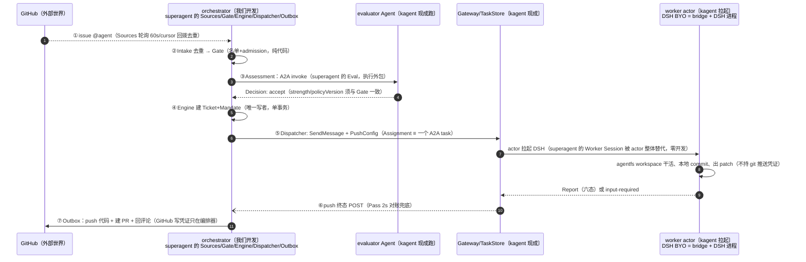
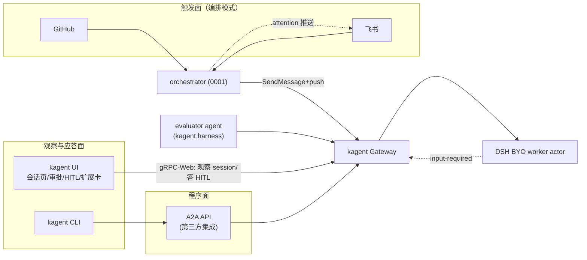
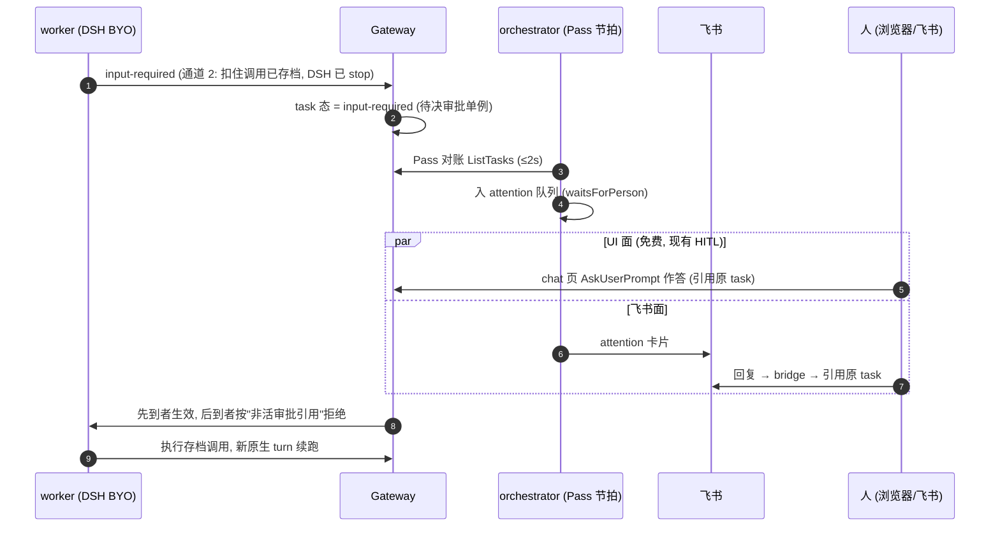

# 0002 — DeepSeek harness 落地 kagent 与对外使用面设计（superagent-on-kagent 的运行时与入口）

*   **Author:** jerry-jibu × ZCode
*   **Status:** Proposed
*   **Date:** 2026-11-14

> 注记：本文迁自 agent-data-workspace（设计探讨工作区）。文中 `0009` 等编号指该工作区 `docs/learnings/` 下的学习笔记；关键事实已内联为 kagent 仓库的 file:line 引用，本文自洽可读。`docs/env.md` 指本仓库部署速查（`docs/env-playbook` 分支）。决策编号 D7–D9 延续 0001 的 D1–D6。本文已过 EGM 全量评审（2026-11-14），修订已并入。

--------------------------------------------------------------------------------

## Overview

0001 设计了 superagent 的编排层（Sources/Gate/Evaluator/Engine/Dispatcher/Outbox/Attention bridge），但把两件事留白了：worker 运行时只写了"DSH BYO（0009）"四个字；人际交互只画了飞书卡片和一个未设计的 "Panel (P1)" 占位。本文把这两块补齐，并给出一句话约束下的完整方案：

> **DeepSeek harness 用 BYO 契约零改动落地（kagent 上游产品代码 P0 零改动）；对外只有四个入口（按通道计：GitHub、飞书、kagent UI、CLI/A2A API）；UI 内核代码零改动，needs-attention 聚合走构建期扩展槽。**

三个组成部分：

1. **DeepSeek harness 三层落地**（模型层 / harness 层 / 打包层）——harness 层有一个真决策：BYO 起步 vs 一等 `deepseek` 类型，本文按"BYO 起步、一等类型设触发条件"展开（D7）。
2. **对外使用面**：两模式（交互 / 编排）× 四入口的矩阵。核心论证：kagent UI 本来就是 harness 无感的（只讲 A2A + HITL 扩展头），所以 DSH agent 的交互模式复用是构造性免费的。
3. **UI 复用策略**：免费所得清单（带 file:line 依据）、attention 双面应答（UI 原生 + 飞书推送，收敛到同一待决审批）、needs-attention 聚合的构建期扩展方案，以及明确不做清单。

### 术语约定（消歧）

*   **DSH**：DeepSeek Harness——byo-ext PR #2 提供的桥接运行时（Go bridge 包裹 DeepSeek CLI，每 turn 一进程，状态在 durable /data）。
*   **bridge 双关**：文中 "DSH bridge" 一律指镜像内的 Go bridge；"Attention bridge" 一律指 0001 编排器的飞书出站组件。延迟预算里的"bridge 出站"指后者。
*   **A2A**：agent 间通信协议（kagent 的 task/消息层）；task 有终态/非终态，push 通知只承诺终态。
*   **substrate / actor / DATA**：kagent 的算力层——worker 以 actor 进程跑在 gVisor 沙箱 WorkerPool；`/data` 为跨挂起/替换存活的持久卷（DATA），快照=卷+状态。
*   **agentfs**：一个组件三种用法——workspace（每工单一目录的持久工作区）、MCP 工具（`agenticfs_*`）、桥（集群内 agentfs 服务的 MCP 端点）。
*   **HITL / ACP**：HITL=human-in-the-loop（kagent 的 input-required/审批扩展头）；ACP=Agent Client Protocol（DSH CLI 的原生会话协议，其权限请求即审批通道 1）。
*   **两个网关**：kagent Gateway（A2A 入口）≠ egress 网关（出站注入模型凭证）。
*   **1006 红线**：学习系列编号（substrate 凭证注入篇）——bridge 沙箱内零外部凭证。
*   **superagent**：工单驱动的主动式编排 agent 模式（监听外部事件→评估→派工→回话，0001 从 dsh-superagent-prototype 提炼）。

### 组件来源与视角（谁是谁）

一句话：**orchestrator 是我们全新开发的 Go 服务——不是 kagent 的组件，也不是 superagent 的代码移植；superagent 在本架构中是"规格书"，kagent 是"执行引擎"，orchestrator 是把规格翻译到引擎上的新代码。**

| 来源 | 角色 | 本文对应 |
|---|---|---|
| superagent（dsh-superagent-prototype，TS 原型） | **规格书**：领域模型/谓词/铁律已被原型验证；零代码复用 | §1 语义、0001 §3 映射 |
| 本设计 → 新 Go 代码 | **编排层**：Sources/Gate/Engine/Dispatcher/Outbox/Attention bridge，独立 Deployment + 自有 PG schema | 0001 全文 |
| kagent v1.0.1（现成，零改动） | **执行引擎**：A2A/会话/HITL/substrate actor/agentfs/egress | 本文全部 file:line 锚点 |
| byo-ext PR #2（pr-2 分支） | worker 运行时镜像源 | A4 |

以 superagent 视角看一个 issue 的生命周期（每个环节标注归宿）：

## The Problem

两个缺口：

1. **harness 落地未定义**。0001 的 worker 是 DSH BYO，但 kagent 的 Harness CRD 有四种类型（`kagent/codex/claude/byo`，`go/api/v1alpha3/harness_types.go:131-161`），DeepSeek 走哪条、模型侧怎么配、镜像怎么发、审批通道对 superagent 的 attention 流有什么硬约束——都没定。其中一条是硬约束：**结构化输出对非 kagent harness 一律被编译器拒绝**（`go/core/internal/translator/compiler.go:332-334`），这直接影响 evaluator（需要结构化 Decision）与 worker（不需要）的 harness 选型。
2. **使用面未成文**。人从哪里进来？0001 §4.2 里 "GW → O: Attention bridge 捕获" 连检测机制都没写（input-required 是非终态，0004 的 push 语义只承诺终态）。0001 的 "Panel (P1)" 若建成独立前端，就要复制一套 SPA + 认证 + 部署，而 kagent UI 已有构建期 app-extension 框架（13 个扩展槽，`ui/src/appExtensions/extensionPoints.ts:11-25`）正好留了这个缝。

## Goals

1. **安装零改动**：DeepSeek harness 的安装只靠 kagent 已有机制（kubectl apply 现有 CRD + egress 注入），P0 对 kagent 上游产品代码零改动（本 fork 分支仅新增 `deploy/` 清单与文档）。
2. **交互模式零学习成本**：DSH agent 在 UI/CLI 里与 kagent/codex/claude agent 在已验证范围（流式对话、工具审批 HITL）内表现一致；checkpoint/fork 以 0009 持久化契约为前提，P0 验收单列（state.json 耦合是 0009 §6 已知中危项）。
3. **入口收敛**：编排模式（superagent）的全部人际交互收敛到四个入口，无新门户、无第二前端。
4. **UI 内核零改动**：会话页=工单执行视图、HITL 应答、harness 管理全部复用现有页面；needs-attention 聚合以构建期 app-extension 实现（dashboard 头卡 + nav + 工单页），交付为一个 npm 扩展包。
5. **门控语义一致**：四个入口执行同一套门控（0001 §7）：门在编排器、消息内容是输入不是权限、凭证三域不混居。

## Non-Goals

*   不做运行时远程 UI 插件加载——kagent 的扩展机制是构建期（`ui/src/appExtensions/activeExtensions.ts:25-27`），保持。
*   不复述/不修改 0001 编排器内部设计（Engine/Store/Outbox/Source 照 0001 执行）。
*   不新增 DeepSeek `ModelProvider` 枚举（`go/api/v1alpha3/modelconfig_types.go:32-46` 无此项；Anthropic 兼容 baseUrl 已是仓库先例，见 A1）。
*   不把飞书做成唯一应答面，也不做 UI 侧策略编辑（policy 是编排器的 ConfigMap，UI 至多只读）。
*   P0 不做 needs-attention 聚合视图与工单列表页（P1 扩展包交付）。

## Open Questions

*   **Q1 — input-required 感知的节拍验证**：本文把编排器感知 input-required 定为 Pass 对账检测（§3，D9）。2s 节拍下飞书卡片的端到端延迟（对账≤2s + Attention bridge 出站）是否达标，**待 P1 实测**（飞书通道与卡片是 0001 的 P1 交付；本设计的 P0 attention 出站仅含编排器侧记录与 UI 面）；不达标再议 push 语义扩展（那是 kagent 侧改动）。
*   **Q2 — 扩展包到编排器的网络路径**：P1 的 ListAttention 是编排器的只读 gRPC-Web 端点，浏览器直连需要 ingress/oauth2-proxy 路由配置（UI 现在同源 `/api` 只指向 controller，`ui/src/api/transport.ts:1-18`）。P1 落地时定：编排器挂同一 oauth2-proxy 后面 + UI 侧 operation override 指向其 base URL（扩展框架有 base-URL resolver seam，`transport.ts:122-132`）。
*   **Q3 — 会话列表状态标签**：conversations 列表的 StateTag（`ui/src/components/agent-instances/InstanceTags.tsx`）是否已把 awaiting_input 显示为独立标签，实现时核实；若已显示，P0 的"聚合"就有零成本替代。
*   **Q4 — share-link 只读旁观**：UI 有 share-link 机制（`X-Share-Token`，`ui/src/api/shareToken.ts`），能否把工单 session 以只读 share 链接发给干系人旁观进度——P2 再议（share-link 是读视图，不开放应答）。

## Critical User Journeys (CUJs)

### CUJ 1: 管理员安装 DeepSeek harness（交互模式就绪）

*   **Given**: kagent 集群 substrate 可用；DSH BYO 镜像已在 registry，digest 钉死（0009 §1 契约）。
*   **When**: 依次 apply ModelConfig（deepseek = Anthropic provider + baseUrl，见 A1）、Harness（`byo:{}` + workload image/command）、Agent（Template ref + HarnessRef）。
*   **Then**: UI `/agents` 的 Harnesses tab 列出该 harness；引用它的 agent 出现在**删除确认文案**里（`referenced()` 仅用于确认，不展示常驻引用列表，`HarnessesTab.tsx:78-136`）；开对话即用 DeepSeek 模型；bridge 沙箱内无模型凭证（模型凭证经 egress 网关注入，1006 红线）。

### CUJ 2: 用户直接与 DSH agent 对话（交互模式，superagent 不在场）

*   **Given**: CUJ 1 完成。
*   **When**: UI `/agents/:ns/:name` 开对话，或 kagent CLI 发消息。
*   **Then**: 流式应答、原生 ACP 权限请求→HITL 审批全部照现有 agent 工作（checkpoint/fork 见 Goal 2 注）；UI 对 harness 类型无感知（它只讲 A2A + HITL 扩展头，见 §2 论证）。

### CUJ 3: superagent 工单从外部触发到 UI 旁观（编排模式）

*   **Given**: 0001 P0 运行中（编排器 + evaluator + worker 就位）。
*   **When**: GitHub issue 里 @agent。
*   **Then**: Engine 以**服务账号身份**建 Ticket ↔ kagent session ↔ agentfs workspace；UI 会话列表按创建者隔离（`useAgentInstances.ts:11-25`，`all_creators` 视图 403 回退）——编排器建的 session 经 SessionService share（只读链接）发给工单干系人；**工单状态的权威视图在编排器侧**（P1 工单页/ListAttention），chat 页是执行细节视图：进度、流式输出、checkpoint 分隔符（UI 内核代码零改动；Ticket↔session 映射红利，0001 §3）。

### CUJ 4: attention 双面应答（UI 原生 + 飞书推送收敛）

*   **Given**: worker 发出 input-required（受保护 MCP 通道 2——保原 task 连续的唯一通道，0009 §4）。
*   **When**: 用户在 UI chat 的 AskUserPrompt 作答（`ui/src/components/chat/AskUserPrompt.tsx:96-135`，A2A 引用原 task）；**或**在飞书卡片回复（P1——飞书通道与卡片是 0001 的 P1 交付；Attention bridge 扇出→引用原 task 送决策）。
*   **Then**: 两条路径收敛到同一 A2A task 的同一待决审批（单例：先到先得，后到按"非活审批引用"显式拒绝）；worker 续跑；两侧视图一致。

### CUJ 5: needs-attention 聚合（P1，扩展包）

*   **Given**: UI 构建包含 superagent 扩展包（构建期注册）。
*   **When**: 打开 dashboard，或点 nav 的"工单"。
*   **Then**: dashboard 头卡槽（`app_dashboard_dashboardOverview_summaryGrid_leadingCard`）显示等待人数与列表入口；工单页只读列表（状态/等待原因/归属 agent），点击跳转对应 conversation。

## Technical Plan (Architecture)

### 1. DeepSeek harness 三层落地

#### A1 模型层——已有，零改动

仓库先例（`docs/env.md:61-62`）：ModelConfig `deepseek` = provider **Anthropic** + `baseUrl: https://api.deepseek.com/anthropic` + Secret（`kagent-deepseek`，存 ANTHROPIC_API_KEY）。0009 原型走的是 OpenAI 兼容（`api.deepseek.com/v1`），两条协议 DeepSeek 官方都提供；**P0 取仓库已验证的 Anthropic 变体**（D8）。注：byo-ext PR #2 官方模板（`examples/agent.yaml.tmpl`）给 DSH 配的是 **OpenAI 兼容**变体（provider OpenAI + `apiKeySecretKey: OPENAI_API_KEY`）——两种配对桥都能吃（ModelConfig 对 bridge 是不透明配置），P0 维持 Anthropic 变体因集群已有验证过的 Secret/ModelConfig 零新增；若 DSH 侧 OTLP usage 校验要求特定 provider 配对再按模板切换。不新增 ModelProvider 枚举：枚举改动会波及 API 类型、telemetry 映射、UI 表单，而 baseUrl 覆盖已达成同一效果。

#### A2 harness 层——BYO 起步（D7，核心决策）

同一 DSH bridge 镜像，两个落点的对照：

| | **BYO（P0 选定）** | 一等 `deepseek` 类型（P2 候选） |
|---|---|---|
| kagent 仓库改动 | **零** | 8 处（清单见实现计划） |
| CRD 写法 | `spec.byo:{}` + `workload.image`(digest) + `workload.command`（`harness_types.go:134-135` 强制） | `spec.deepseek:{}`，镜像进 `HarnessImagesConfig` 默认打包 |
| 能力差异 | 无——BYO 编译器把 command/args 直通、注入 KAGENT_CONFIG_JSON/AgentCard（`translator/byo/compiler.go:84`） | 只是**打包/命名/UX 升级**，不是新运行时 |
| UI 呈现 | Harnesses tab 正常列出、正常删除 | 同左 + 表单可特化 |
| 结构化输出 | 不可用（非 kagent harness 一律拒绝，`compiler.go:332-334`） | 同样不可用（除非另改编译器） |

判据：**BYO 不是妥协，是 0009 已通过集群验收的同一条路径**（`go/core/test/e2e/harness_test.go:20-30` 的 e2e 就是拿 Go ADK 镜像跑 BYO）。一等类型的收益（默认镜像、CRD 命名、表单特化）只在复用规模出现后有价值。**升级触发条件（满足其一进 P2）**：① 出现 ≥2 个共享 DSH 配置的 agent 群，配置样板成为负担；② 需要 harness 级编译校验（如把 0009 的"bridge 拒 API-key passthrough"从运行时前移到编译期）；③ UI 需要按 harness 类型特化创建表单。

**evaluator 与 worker 的 harness 选型由此锁定**：worker = DSH BYO（结构化输出不可用无所谓——0001 已定 Report 走 prompt 约定 + 代码解析）；evaluator = **kagent harness** agent（结构化 Decision 的唯一通路，0001 D1 不变）。

#### A3 审批通道对 attention 的硬约束

0009 §4 三通道中，superagent 的 attention 流（0001 §4.2：回复引用原 task 送决策）**只能依赖通道 2（受保护 MCP）**：通道 1（原生 ACP 权限）活不过 DATA 快照/进程替换，通道 3（外部审批服务）不保原 task 连续。落地含义：**worker 的 agentfs/MCP 工具清单里，需要"等人后继续原工单"语义的操作必须走 `requireApproval`**（这是 `MCPToolBinding` 的一等字段，`agenttemplate_types.go:42-48`，可按 `Tools` 圈定范围）；编排模式的 worker template **禁用**会触发通道 1 的 DSH 内置权限（策略=拒绝）——通道 1 请求不产生 input-required 态，D9 的检测对它不可达，唯一安全做法是令其不发生；若因配置漂移仍发生，桥按显式拒绝处理并计入 Report（failed），不做静默等待。交互模式（CUJ 2）不受此限。这一条写进 worker 的 template 约定，是 0001 "bridge 契约"的具体化。

#### A4 打包与分发（出处已锚定）

DSH BYO 镜像源码：上游 `kagent-dev/byo-ext` 仓库的 **PR #2「Add DeepSeek Harness」**（<https://github.com/kagent-dev/byo-ext/pull/2>，分支 `pull/2/head`；本地已取为 `pr-2` 分支检出）。**该 PR 未合入上游 main**——main 只含社区 harness 脚手架（`templates/harness/Dockerfile`），`harnesses/deepseek/`（Go bridge + Node DSH 双运行时，自带 `Dockerfile` 与 `VERIFICATION.md`）仅存在于 PR 分支。镜像从 PR 分支的 `harnesses/deepseek/Dockerfile` 构建，push 到 registry、digest 钉死写进 Harness CR；**构建归属 agent-data-workspace 的流水线**（kagent 仓库零 diff 不受影响）。我们的三份 manifest 以其 `harnesses/deepseek/examples/agent.yaml.tmpl` 为蓝本——该模板同时示范了实际字段名：`apiKeySecret`/`apiKeySecretKey`、`workerPoolRef.name`/`snapshotPolicy.location`。**helm 无需任何改动**——BYO 镜像引用随 CR 走，不进 `HarnessImagesConfig`（那是内置类型默认镜像的机制，`helm/kagent/values.yaml:153-156`）。`Harness.Spec.Env` 只收字面量（secret ref 被显式推迟，`runtime_types.go:8-20`）——与"bridge 零凭证"契约一致，无需放宽。

#### A5 工作区物化与上下文可达（D10 定案，详设见 [0003](./0003-工作区物化与上下文可达性.md)）

工单工作目录的代码物化采用**编排器预置**：Engine accept 后编排器（持 GitHub 凭证）浅克隆 `--depth 1` 物化进工单工作区，worker 离线做本地 git（DSH BYO 镜像已含 git/ripgrep/bash，byo-ext `Dockerfile:15`）产出 `format-patch`，**编排器取回并 push/建 PR**（凭证只在编排器，worker 无凭证且 remote URL 不嵌 token）。worker 自取 clone 为 P2 演进——前提是 EgressPolicy 放行 `github.com:443`（`agent_types.go:65` 原生扩展点）+ egress 层 git 凭证注入（新机制）；github.com 在 BYO 编译期 egress 白名单之外（`byo/compiler.go:77-79`），当前网络层即禁止。上下文可达性红线：跨 agent 运行时上下文**不共享**（仅按值注入/编译期 subagent），跨 actor 经 DATA 恢复**可达**。验证场景 V1–V7 见 0003。

### 2. 对外使用面：两模式 × 四入口

| 入口 | 模式 | 能做什么 | 靠什么 | 改动 |
|---|---|---|---|---|
| GitHub | 编排 | 触发/追问/收尾确认 | 0001 Sources/Outbox | 编排器内（0001 范围） |
| 飞书 | 编排 | 触发/attention 卡片/续命/停止 | 0001 bridge + 本文 §3 检测机制 | 编排器内 |
| kagent UI | 两模式 | 交互对话；旁观工单执行；回答 HITL；管 harness/模板/模型/actor；P1 聚合卡与工单页 | 现有页面 + §4 扩展包 | 扩展包（构建期） |
| CLI / A2A API | 两模式 | 交互对话；程序化派发与集成（编排器与 CLI 同地位，0001 §5） | A2A SendMessage/push | 零改动 |

**UI harness 无感的论证**（"尽量继续使用它的 UI"的承重墙）：UI 聊天走 `A2AService/SendStreamingMessage` + `A2A-Extensions: hitl/v1` 头（`ui/src/api/chat/a2aGrpcChatClient.ts:583`、`ui/src/api/chat/hitl.ts:37-40`），不问 harness 是谁；harness 差异被 Gateway/编译器吸收在 `KAGENT_CONFIG_JSON` 里。因此：**任何新 harness（包括未来的 P2 一等 deepseek）在交互模式下对 UI 的成本恒为零**；只有编排模式的聚合视图（工单、needs-attention）是 UI 不认识的新领域对象，走扩展槽补。

### 3. attention 的检测与双面应答（补 0001 的机制缺口）

**检测（D9）**：0001 §4.2 的 "GW → O: Attention bridge 捕获" 未定机制，且 A2A push 只承诺终态（0004）。本文定：**Pass 对账检测**——编排器 2s 节拍的 reconcile（0001 D2 已有）在扫描 running Assignment 时顺带过滤 `input-required` 态 task，发现即入 attention 队列。零新 push 语义、复用既有节拍与幂等记账；代价是感知延迟 ≤ 2s + bridge 出站（Q1）。

**收敛与幂等**：待决审批是 task 上的单例；"先到先得 + 后到显式失败"不是天然性质，而是 Gateway 审批注册的机制保证（`go/adk/pkg/a2a/hitl.go:578` 只认 task 态与待决审批；PrepareSend/RevokeSend 原子化引用审批的注册/撤销）——双面竞争纳入验证计划的 e2e。**答侧授权**：飞书决策人须为该 Ticket 订阅 Thread 的成员（0001 订阅扇出语义）；Gateway 不验提交者身份（`hitl.go:578` 只验 task 态），身份校验是编排器 Attention bridge 的职责（飞书 user id 映射进审计记录）。**卡片失效刷新（P1，非顺带）**：Attention bridge 须持久化卡片 ID（Store.attention），审批被消费后经飞书卡片更新 API 置灰；更新失败最多重试一次，以编排器状态为准——P0 不做卡片刷新，卡片文案自带"以编排器状态为准"提示。

### 4. UI 复用与扩展

**免费所得（零改动，全部已验证存在）**：

| 需求 | 现有机制 | 依据 |
|---|---|---|
| 工单执行视图 | Ticket↔session 映射 → conversations 列表 + chat 页（进度/流式/状态 tag） | `AgentPage.tsx`、`routes.ts:41-50` |
| 执行历史回放 | 消息记录、checkpoint 分隔、fork | `CheckpointDivider.tsx`、`CheckpointService/ForkSession` |
| HITL 应答 | input_required→awaiting_input、ask_user/tool_approval 渲染与提交 | `turnMachine.ts:133,225`、`AskUserPrompt.tsx:96-135` |
| harness/agent 管理 | Harnesses tab、AgentTemplate 页、models、substrate 页 | `HarnessesTab.tsx:70-118` 等 |
| 认证 | oauth2-proxy cookie（编排器/网关同域复用） | `AuthProvider.tsx:18-27` |

**构建期扩展包（P1，新代码但不碰 UI 内核）**：

1. **dashboard 头卡**：槽 `app_dashboard_dashboardOverview_summaryGrid_leadingCard`——needs-attention 计数 + 列表入口。
2. **nav 注入 + 工单页**：扩展路由贡献一个只读工单列表（Ticket 状态/等待原因/归属），点击跳 `conversation` 页。
3. **数据路径**：编排器新增只读 `ListAttention` gRPC-Web 端点（**编排器是 waitsForPerson 谓词的唯一所有者**——纯扫 A2A ListTasks 拿不到"此后无人发言"语义，故不走 UI 侧扫描）。**读侧授权**：已认证（oauth2-proxy）用户可见 needs-attention 计数；工单明细限编排器 policy 的 operator 名单——与写侧门控（0001 §7）对偶。扩展包数据接入用 operation override 携带**自有 transport** 指向编排器：全局 base-URL resolver 是单值（`transport.ts:110-132`）不能改指，正确组装是扩展的 `operations` override 自带 transport（`extensionApi.ts:75`）（Q2）。
4. **注册**：扩展包在 `ui/src/appExtensions/activeExtensions.ts` 注册——这是对 UI 内核的**唯一一处**触碰，且是扩展框架设计的注册点。该提交由本 fork 的 exp 分支维护（随上游演进定期 rebase），扩展稳定后考虑上游 PR。

**明确不做**：运行时插件加载；替换 shell/主题；把 UI 做成触发面（触发留在 GitHub/飞书——UI 里"直接对话"已经覆盖交互模式）；UI 侧策略编辑。

## Alternatives Considered

### Alternative A: 立即做一等 `deepseek` harness 类型

*   **Pros**: CRD 命名进 ExactlyOneOf、默认镜像进发布包、UI 表单可特化、0009 的运行时拒绝可前移为编译期校验。
*   **Cons**: kagent 仓库 8 处改动（API 类型+CEL、编译器注册表与 switch、新 translator 包、reconciler 接线、images.go、proto `HarnessImagesConfig`、helm helpers、release 校验、gRPC 面），且每处都要重生成与回归；而 BYO 已被 e2e 与 0009 集群验收覆盖。
*   **Reason for Rejection**: Rejected by author——P0 的目标是验证使用面，不是打包面；一等类型只是便利性升级，已设触发条件（A2 表）进 P2。

### Alternative B: 独立 Panel 前端（0001 "Panel (P1)" 的字面实现）

*   **Pros**: 不碰 kagent UI 仓库；可独立演进。
*   **Cons**: 复制一整套 SPA + 认证（oauth2-proxy）+ 部署 + 会话跳转（还得跨站链接回 kagent UI）；而 kagent UI 的扩展框架正好提供构建期缝（头卡/nav/路由三槽全覆盖需求）。
*   **Reason for Rejection**: Rejected by author——第二前端的长期维护成本高于一个扩展包；0001 的 Panel 占位由本文 §4 的扩展包取代。

### Alternative C: attention 只走飞书（砍掉 UI 应答面）

*   **Pros**: 少论证一个收敛面。
*   **Cons**: UI 的 HITL 应答是现成的（AskUserPrompt 已实现引用原 task 提交），砍掉是负成本收益；工位场景 UI 比 IM 更顺手。
*   **Reason for Rejection**: Rejected by author——双面应答的收敛机制（审批单例）不因多一个面而复杂化。

### Alternative D: 新增 DeepSeek `ModelProvider` 枚举

*   **Pros**: 模型表单一等公民；discovery 可特化。
*   **Cons**: API 类型 + telemetry 映射 + UI 表单三处波及；Anthropic-baseUrl 已工作（`docs/env.md:61-62`）。
*   **Reason for Rejection**: Rejected by author——无功能增益的 API 面扩大。

### Alternative E: Go wrapper 包裹 superagent 原型本体（跑 TS 引擎 + Go 适配 kagent）

*   **Pros**: 语义零漂移（引擎即 superagent 本人）；原型演进自动跟进。
*   **Cons**: wrapper 不薄——superagent 的执行边界（本地 DSH inbox、单机守护治理 pid/lock/日志滚动）与 kagent runtime（actor 沙箱/HITL/agentfs/egress）在同一个边界上整体互斥，适配 executor/attention/channel 三个边界 = 两边都写全量代码，且一半写在原型级 TS 里；Node 运行时进编排器部署、双状态源、单机进程治理假设与 k8s Deployment 冲突；代码级兼容是幻觉（原型 churn 的是代码，稳定的是规格）。
*   **Reason for Rejection**: Rejected by author——superagent 的稳定产出是其领域规格（docs 001/002/003/007），不是代码；规格级兼容可测可得，代码级兼容不可得也无必要。替代：下方兼容策略。

--------------------------------------------------------------------------------

## 与 superagent 的兼容策略（钉规格，不包代码）

兼容分层与手段：

| 兼容层 | 保 | 手段 |
|---|---|---|
| 语义/行为（Trigger 确定性、cursor -5s、admission strength、waitsForPerson/followupOwners、Engine 唯一写者、Outbox receipt） | ✅ | 规格钉版 + 符合性测试：每条不变量落成 Go 测试（given-when-assert-that），测试名即规格条款 |
| 外部表面（GitHub 评论 marker、飞书消息语义、deterministic trigger ID 方案） | ✅ | 沿用原型约定——同一 Thread 历史可被任一实现消费 |
| 代码/内部状态（TS 实现、Store schema、DSH inbox 进程接口） | ❌ | 正是被 kagent 替代的机制，刻意不保 |

机制落点：

1. **规格钉版**：语义锚定 superagent docs 001/002/003/007 当前版本；上游演进 = 显式 spec review 并更新本节，不静默漂移。
2. **符合性测试**：上述不变量在 orchestrator 单测中逐条对应（进 P0 验证计划）。
3. **外部 marker 对齐**：trigger ID 方案与评论 marker 沿用原型格式（P0 Source 实现时核对原型常量）。
4. **差分测试（P2 可选）**：同脚本触发场景喂原型与 Go 实现，diff Ticket 状态机——原型具备无头 harness 时才做。

--------------------------------------------------------------------------------

## Non-Functional Requirements

*   **Security**：凭证三域不混居——UI 用户（oauth2-proxy）、编排器（GitHub token/飞书 app Secret）、agent（模型凭证仅经 egress 注入，bridge 零凭证，1006）。share-link 是读视图，不开放 HITL 应答。MCP 重定向 same-origin 限制（0009 §6）继续约束 agentfs 桥。门控语义四入口一致（0001 §7）：消息内容是输入不是权限。
*   **Performance & Latency**：attention 端到端 = Pass 对账（≤2s）+ bridge 出站 + IM/浏览器投递；评估 invoke 与 worker 派发延迟归 0001。UI 扩展包只在 dashboard/工单页调用 ListAttention，不进聊天热路径。
*   **Rollout & Rollback**：扩展包是构建期附加物，回滚=从 `activeExtensions.ts` 摘除重建；harness 是 per-agent 资源，回滚=删 Agent/Harness CR；模型配置隔离在 ModelConfig + Secret。kagent 上游产品代码 P0 零改动，无上游回滚面。

### 风险与缓解

| 风险 | 缓解 |
|---|---|
| Pass 2s 对账随 agent×task 规模增长的成本 | P0 单 agent 规模小；P2 引入增量游标/只扫活跃 task |
| attention 队列老化（无人理的工单） | waitsForPerson 已定义挂起语义；P2 加老化升级通知 |
| 飞书 API 限流（卡片更新/扇出） | 批量与去抖；卡片失效刷新失败不重试超过一次（§3） |
| Anthropic 兼容层漂移（DSH 侧校验要求特定配对） | A1 已留 OpenAI 兼容切换路径（官方模板同款配对） |
| PR #2 未合入上游（rebase/强推/集成形态变更） | 构建记录源 SHA（当前 `19771c8`）→ 镜像 digest 对应关系；显式重同步不自动漂移；升级前按 0009 upgrade 契约重验持久化格式 |

--------------------------------------------------------------------------------

### Additional Resources

*   [0001-superagent-on-kagent-编排层设计](./0001-superagent-on-kagent-编排层设计.md)（编排层，本文的上游）
*   `0009 — DSH BYO 集成与执行链`（BYO 契约/三审批通道/红线）
*   byo-ext PR #2（DSH BYO 桥源码与官方 manifest 模板，未合入上游 main）：https://github.com/kagent-dev/byo-ext/pull/2（本地已取 `pr-2` 分支）
*   kagent 仓库实读（2026-11-14）：`go/api/v1alpha3/harness_types.go`、`go/core/internal/translator/compiler.go`、`go/core/internal/controller/reconciler.go`、`ui/src/`（router/api/appExtensions）、`docs/env.md`

### Future Improvements

*   **The idea**：P2 一等 harness 类型若触发，把 0009 的 state.json↔原生日志耦合校验（0009 §6 中危项）一并前移进编译器 startup check。

--------------------------------------------------------------------------------

## Detailed Implementation Plan

### Target Files to Create/Modify

**本仓库（fork 分支 `exp/deepseek-superagent`，P0）**——2026-11-14 决定：部署清单与设计稿同分支演进；agent-data-workspace 仅存文档档。对上游的"零改动"指产品代码；`deploy/` 新增清单随本分支走。

#### 1. `deploy/kagent/modelconfig-deepseek.yaml` (Create)

*   **Type / Scope**: k8s manifest（ModelConfig + Secret 引用模板）。
*   **Proposed Changes**: Anthropic provider + `baseUrl: https://api.deepseek.com/anthropic` + `apiKeySecret`/`apiKeySecretKey`（实际字段名；byo-ext 模板同款键位，provider/baseUrl 换 Anthropic 变体）；model 取集群现值（`deepseek-flash`，env.md）；Secret 值不入库，README 指向创建命令。

#### 2. `deploy/kagent/harness-dsh-byo.yaml` (Create)

*   **Type / Scope**: k8s manifest（Harness CR）。
*   **Proposed Changes**: `spec.byo:{}` + `workload.image`（digest 钉死占位）+ `workload.command: [/usr/local/bin/kagent-dsh-byo]` + `env` 字面量白名单 + `substrate.workerPoolRef.name`/`snapshotPolicy.location`（实际键名；值按 env.md 部署惯例：`kagent-default` / 既有快照位置）。**以 byo-ext PR #2 的 `harnesses/deepseek/examples/agent.yaml.tmpl` 为蓝本**（provider/baseUrl 按本文 A1 换 Anthropic 变体）。零 CRD 扩展。

#### 3. `deploy/kagent/agent-worker.yaml`、`agent-evaluator.yaml` (Create)

*   **Type / Scope**: k8s manifest（Agent CR ×2）。
*   **Proposed Changes**: worker = **inline template** + HarnessRef(dsh-byo)（P0 内联，免多一个 AgentTemplate CR），tools 绑定 agentfs 的 RemoteMCPServer（`MCPToolBinding.server`，kind=RemoteMCPServer），"等人后继续"语义的操作用一等字段 `requireApproval: true`（`agenttemplate_types.go:42-48`），A3 的通道 1 禁用写进 prompt/权限策略；evaluator = HarnessRef(`kagent-default`——1.0.1 onboarding 内置 kagent harness，env.md 已录）+ inline template + `outputSchema` 结构化 Decision（`agenttemplate_types.go:194`；`compiler.go:332-334` 使其必须用 kagent harness）。`Harness.Spec.Env` P0 置空（bridge 无需额外字面量），待需求出现再加。

**本仓库同分支（P1）**——编排器代码亦落本 fork 探索分支

#### 4. `orchestrator/internal/attention/v1` (Create)

*   **Type / Scope**: Go gRPC-Web 只读服务（编排器内）。
*   **Proposed Changes**: `ListAttention` 返回 waitsForPerson 谓词命中的工单（id/ticket 状态/等待原因/agent/session 引用）；proto P1 动手时定义，最小面 `ListAttention(request) returns (response)`；数据来自编排器自有 Store，无新写路径。

#### 5. `ui-extensions/superagent-panel/` (Create) + `ui/src/appExtensions/activeExtensions.ts` (Modify)

*   **Type / Scope**: npm 扩展包 + UI 仓库注册点（唯一一处 UI 内核触碰）。
*   **Proposed Changes**: dashboard 头卡（needs-attention 计数）、nav 注入 + 工单只读页、`ListAttention` operation override 携带自有 transport 指向编排器（见 §4）；Playwright 用例挂 `ui/playwright/tests/extension-points/` 惯例。

**kagent 仓库（P0 零改动；P2 触发后的一等类型清单，逐项对应验证过的位置）**

1. `go/api/v1alpha3/harness_types.go` — `DeepSeekHarness` 空结构体 + spec 字段 + CEL ExactlyOneOf 五选一（仿 :131-161）。
2. `go/core/internal/translator/compiler.go` — `HarnessTypeDeepSeek` 常量（:32-37）+ `harnessType()` case（:187-200）。
3. `go/core/internal/translator/deepseek/compiler.go` (Create) — 实现 `HarnessCompiler`，本质是 BYO 编译器 + 默认镜像/校验；上游 byo-ext main 的 `templates/harness/` 脚手架是社区 harness 的官方形态，一等化时对齐。
4. `go/core/internal/controller/reconciler.go` — 注册表接线（:141-145）。
5. `go/core/internal/translator/images.go` + proto `HarnessImagesConfig` — 默认镜像。
6. `helm/kagent/templates/_helpers.tpl:8` + `scripts/harness-image-catalog.sh` — 打包列表（`helm/kagent/files/builtin-harness-images.json` 是发布期生成物且被 gitignore，`Makefile:455-457`，不可手编）。
7. `go/core/pkg/app/images.go` — release 校验（:10-16）。
8. `go/core/internal/grpcserver/harness.go` — gRPC 面名字（:21-25）。
9. deepcopy/CRD YAML 重生成（`make -C go generate`，`helm/kagent-crds/templates/api.kagent.dev_harnesses.yaml` 的 CEL :256-262）。

### Verification Plan

*   **Compilation/Build**: `make -C go build`（若走 P2）；DSH BYO 镜像构建（记录源 SHA `19771c8` → 镜像 digest 对应关系，见风险表）；UI `yarn build`（仓库为 yarn 4.9.0，`ui/package.json:6`）。
*   **Unit Tests**: 编排器 `ListAttention`/waitsForPerson 语义（given-when-assert-that，`.agents/skills/given-when-assert-that/SKILL.md`）；attention 检测的 Pass 对账用例（input-required 进队、审批消费后出队、双面竞争后到拒绝、通道 1 请求被显式拒绝路径）。
*   **E2E/Integration**: 在本 fork 分支以 `make -C go e2e` 复用 BYO e2e 模式（`go/core/test/e2e/harness_test.go:20-30`）跑三份 manifest——测试基建改动只在本分支，不进上游；CUJ1–CUJ5 手动走查清单；扩展包 Playwright（`yarn test:pw`）。
*   **Latency 验证**: Q1 实测（P1）input-required→飞书卡片 P95 ≤ 5s；超标触发 push 语义扩展讨论（kagent 侧改动，需另立项）。

--------------------------------------------------------------------------------

### 附录：Claims & Evidence（承重主张 → 锚点 → 验证状态）

行号基线：kagent v1.0.1（`558e3d76`），验证日期 2026-11-14（EGM 全量评审逐条核验）。

| 承重主张 | 锚点 | 验证 |
|---|---|---|
| Harness 四型 + BYO 强制 image/command | `go/api/v1alpha3/harness_types.go:131-161` | ✅ |
| 结构化输出拒绝非 kagent harness | `go/core/internal/translator/compiler.go:332-334` | ✅ |
| BYO 编译器直通 command/args + 注入配置 | `go/core/internal/translator/byo/compiler.go:84` | ✅ |
| BYO e2e 存在 | `go/core/test/e2e/harness_test.go:20-30` | ✅ |
| UI harness 无感（A2A 流式 + HITL 扩展头） | `ui/src/api/chat/a2aGrpcChatClient.ts:583`、`ui/src/api/chat/hitl.ts:37-40` | ✅ |
| HITL 应答组件引用原 task 提交 | `ui/src/components/chat/AskUserPrompt.tsx:96-135` | ✅ |
| 审批单例/串行化点 | `go/adk/pkg/a2a/hitl.go:578` + Gateway PrepareSend/RevokeSend | ✅（评审补锚） |
| MCP 绑定一等 requireApproval 字段 | `go/api/v1alpha3/agenttemplate_types.go:42-48` | ✅ |
| 13 个构建期扩展槽 | `ui/src/appExtensions/extensionPoints.ts:11-25` | ✅ |
| 会话列表按创建者隔离 | `ui/src/api/hooks/useAgentInstances.ts:11-25` | ✅（评审发现→F7） |
| HarnessesTab referenced() 仅用于删除确认 | `ui/src/pages/agents/HarnessesTab.tsx:78-136` | ✅（F6） |
| ModelConfig 字段名 | `go/api/v1alpha3/modelconfig_types.go:607-616` | ✅（IR-1） |
| substrate 字段名 | `go/api/v1alpha3/runtime_types.go:33-41` | ✅（IR-2） |
| builtin-harness-images.json 为发布期生成物 | `.gitignore:211`、`Makefile:455-457` | ✅（IR-3） |
| UI 包管理器 yarn 4.9.0 | `ui/package.json:6` | ✅（IR-4） |
| transport 全局单值 / 扩展 operations override | `ui/src/api/transport.ts:110-132`、`ui/src/api/extensionApi.ts:75` | ✅（IR-5） |
| DSH 契约/三审批通道/零凭证 | byo-ext PR #2 `harnesses/deepseek/`（pr-2 分支，`19771c8`） | ✅（0009 + 本地检出） |
| Anthropic 兼容变体可用 | `docs/env.md:61-62` | ✅（集群已验证） |

--------------------------------------------------------------------------------

*Drafted with EGM*
