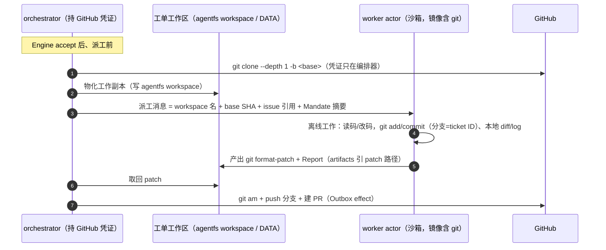

# 0003 — 工作区物化与上下文可达性（kagent 现成方式 / 我们的方式 / 替代方案与验证场景）

*   **Author:** jerry-jibu × ZCode
*   **Status:** Draft
*   **Date:** 2026-11-14

--------------------------------------------------------------------------------

## Overview

0001/0002 定义了"工单工作区"（per-ticket workspace）和"上下文"（Ticket↔session 映射），但留了一个执行层缺口：**代码怎么进工作区、上下文在 actor/agent 边界上到底可达性如何**。本文把这块单独成题：

1. 盘点 kagent v1.0.1 **现成提供**的工作区与上下文机制（以及明确不提供的）；
2. 定案 **我们的方式**（0002 D10：编排器预置浅克隆 → worker 离线 git → 编排器 push/PR）；
3. 列替代方案及其成立前提；
4. 给出**可执行的验证场景清单**（V1–V7），覆盖"上下文跨 actor/agent 可达性"与"沙箱内 git worktree"等常见使用场景。

两个已核实的基础事实（决定全文结论）：

*   **git 在 DSH BYO 镜像内**：`byo-ext` pr-2 `harnesses/deepseek/Dockerfile:15` 安装 `bash bubblewrap ca-certificates git ripgrep`——沙箱内 git 本地操作（add/commit/diff/log/worktree）零网络可用。
*   **egress 是编译期白名单**：`go/core/internal/translator/byo/compiler.go:77-79`——出站目的地 = model provider + control plane + MCP server 绑定（另可加 Agent 的 `EgressPolicyRefs`，`agent_types.go:65`）。**github.com 默认不可达**。

## The Problem

三个具体问题：

1. worker 要改 GitHub 上的代码，工作副本从哪来？（编排器预置？worker 自己 clone？）
2. 改完了怎么出去？（worker 推送需要凭证，违反零凭证红线；编排器代推送则需要取回产物的通道）
3. "上下文"在边界上到底怎么流动：worker 崩了/被替换，上下文还在吗？另一个 agent 能看到 worker 的上下文吗？

## kagent 现成方式盘点（v1.0.1，逐条验证）

### 提供的

| 能力 | 机制 | 对本主题的意义 |
|---|---|---|
| agentfs workspace | `agenticfs_*` MCP 工具：create_workspace / write_file（intention 审计）/ create_checkpoint / rollback | per-ticket 持久工作区 + 操作审计 + 快照回滚 |
| DATA durable 卷 | substrate DurableDir `/data`（workspace、DSH 会话日志、adapter/state.json） | 跨 actor 替换/挂起的**文件与进程记忆**双持久 |
| substrate 快照/恢复 | `snapshotPolicy.location`（`runtime_types.go:33-41`）；DATA restore | worker 被回收后新 actor 恢复现场 |
| A2A session/TaskStore | `contextId` → 会话历史持久化；CheckpointService（fork） | **控制面**对话上下文，编排器可续写 |
| Shared subagent | `SubAgentToolBinding`（同 ns AgentTemplate 编译期组合进父运行时，`agenttemplate_types.go:70-88`） | 唯一的"跨 agent 上下文"原生形态：**编译期组合**，不是运行时共享 |
| egress 白名单扩展点 | `EgressPolicyRefs`（`agent_types.go:65`） | 路线 B（worker 自 clone）的 kagent 原生扩展位 |

### 明确不提供的

*   **跨 agent 运行时上下文共享**：session 按 agent 隔离；跨 agent 只有两条合法路径——按值注入消息、编译期 subagent 组合。这是红线不是缺陷（0001 §7：消息内容是输入）。
*   **任意卷挂载进 actor**：没有 PVC 机制——工作区即 agentfs/DATA，不引入第三种存储。
*   **对 github.com 的默认出站**：白名单不含 → worker 自 clone 被网络层禁止（与凭证问题无关，先倒在网络层）。

## 我们的方式（0002 D10 定案：编排器预置）

要点：

1. **凭证单调**：GitHub 读（Sources 轮询）、clone、push/PR 全在编排器；worker 从头到尾无凭证、remote URL 不嵌 token（防 `.git/config` 泄漏）。
2. **worker 的 git 边界**：本地操作全开（镜像已含 git），`git remote` 类操作被"无凭证 + prompt 约定"双重禁止。
3. **patch 契约**：Report.artifacts 指向工作区内 `patches/<ticket>-<n>.patch`（`git format-patch` 产物）；编排器只消费这个路径。
4. **物化通道可插拔**：本设计只定契约（编排器能把任意目录树物化进工单工作区、并能取回文件）；具体走 agentfs 写入的细节归 agentfs 主题，不在本文展开（用户指令：先不讨论 agentfs 内部）。

## Alternatives Considered

### Alternative B: worker 自取 clone（egress 放行 + 凭证注入）

*   **Pros**: 编排器零 clone 负担；worker 拿到完整 git 语义（fetch 更新基线）。
*   **Cons**: 两个前提都要新建——① EgressPolicy 放行 `github.com:443`（机制存在，`EgressPolicyRefs`）；② git 凭证注入：短时效 fine-grained token 在 egress 层注入 smart-http 请求、永不进沙箱内存（新机制，egress 现在只注入模型凭证）。
*   **状态**: P2 演进项；两个前提各自成立前不启动。

### Alternative C: 预焙镜像（代码进镜像）

*   **Reason for Rejection**: Rejected by author——工单级时效性（issue 指向的 base 分支/SHA）不可能烘焙；镜像重建周期与工单节奏错配。

### Alternative D: 跨沙箱共享 git worktree

*   **Reason for Rejection**: 机制不成立——worktree 依赖同机共享 object 库，沙箱之间没有共享文件系统。worktree 的两个**正确**用法：编排器侧并发工单管理（同 repo 多 worktree，省 clone、共享 objects，可选优化）；沙箱内单 worker 多实验（见 V4）。

### Alternative E: worker 无 git，纯文件编辑 + 编排器统一 commit

*   **Pros**: 最简（不依赖沙箱 git 行为）。
*   **Cons**: worker 失去 diff/log/status 等编码 agent 的核心工具语义，DSH 编码循环质量下降；编排器要做工作区 diff，复杂度转移而非消失。
*   **状态**: P0 的**降级备选**——若 V4/V5 验证出沙箱 git 阻碍，退到此路线。

## 验证场景清单（CUJ 式，V1–V7）

### V1 基线链路（= D10 路线 A 端到端）

*   **Given**: manifest 已 apply（CUJ1 完成）；编排器骨架可跑。
*   **When**: issue @agent → accept → 预置 clone → 派工 → worker 改一个文件 → format-patch → Report。
*   **Then**: 编排器取回 patch、push 分支、PR 建立；patch 内容 = worker 改动；全程 worker 侧无任何 github.com 出站记录。

### V2 跨 actor 上下文（预期：**可达**）

*   **When**: 任务中途 `kill -9` worker pod → substrate 拉起新 actor。
*   **Then**: DATA 恢复 `/data`（repo 工作副本 + DSH 会话日志 + state.json）；同 `contextId` 续发消息，worker 接着上一 turn 干活；git 工作区状态（含未 commit 改动）完整。

### V3 跨 agent 上下文（预期：**不可达——红线确认**）

*   **When**: 用 evaluator 或另一 agent 尝试访问 worker 的 session 与工作区。
*   **Then**: session 隔离（不同 agent 不可见）；工作区按 workspace 名授权（0007 Grant-by-Paste 语义）；合法共享仅剩按值注入与编译期 subagent——把这条记录为**红线**而非待修问题。

### V4 沙箱内 git worktree（用户点名场景）

*   **When**: worker 在工作区内 `git worktree add .trees/exp1`，两个工作树并行改动。
*   **Then**: worktree 创建/切换成功（gVisor 兼容）；`/data` 持久使其跨 actor 替换存活；DSH 工具循环可作用于任一树。

### V5 checkpoint/rollback ↔ git 状态一致性

*   **When**: agentfs create_checkpoint → 继续改动 → agentfs rollback。
*   **Then**: rollback 后 `git status/diff` 与 checkpoint 点一致；两套快照（agentfs 卷级 vs git 内容级）的交互语义被记录（已知风险点，见 Q1）。

### V6 浅克隆规模

*   **When**: 对目标仓库做 depth-1 clone 并物化。
*   **Then**: 体积/时长在工单节拍可接受（目标 <60s / <500MiB）；agentfs 写入审计量可控。

### V7 多仓工单（P2）

*   **When**: 单 ticket 涉及两个仓库。
*   **Then**: 两个 workspace 独立物化，patch 分仓产出；编排器 PR 分仓建立。

## Open Questions

*   **Q1 — 两套快照的语义对齐**：agentfs checkpoint（卷级、含 git 元数据）与 git commit/patch（内容级）粒度不同；rollback 后 git 元数据（HEAD、index）是否随卷一致恢复，V5 实测定案。
*   **Q2 — patch 体积上限**：format-patch 超大（二进制/大量文件）时 agentfs 审计与取回通道的限额；必要时 patch 拆分约定。
*   **Q3 — Route B 的最小设计**（P2）：EgressPolicy 对 `github.com:443` 的放行粒度 + egress 层 git token 注入的位置（atenet-egress 现有注入点是否可复用）。

## Additional Resources

*   [0002 — DeepSeek harness 落地与对外使用面](./0002-deepseek-harness-落地与对外使用面设计.md)（D10 出处、A4 打包、manifests）
*   [0001 — superagent-on-kagent 编排层设计](./0001-superagent-on-kagent-编排层设计.md)（Ticket↔workspace 映射、凭证单调）
*   [0009 — DSH BYO 集成与执行链](../learnings/0009-deepseek-harness-BYO集成与执行链-Tier3.md)（DATA/快照、completion barrier）
*   kagent v1.0.1 实读：`agenttemplate_types.go:70-88`（SubAgent）、`agent_types.go:65`（EgressPolicyRefs）、`translator/byo/compiler.go:77-79`（egress 白名单）、byo-ext `Dockerfile:15`（git/ripgrep/bash）

--------------------------------------------------------------------------------

*Drafted with EGM*
