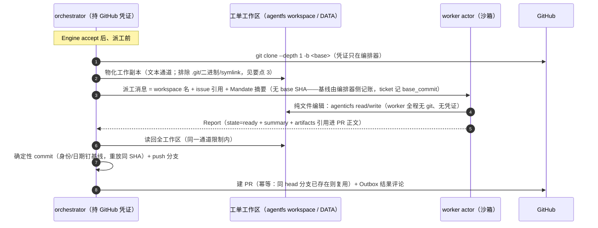

# 0003 — 工作区物化与上下文可达性（kagent 现成方式 / 我们的方式 / 替代方案与验证场景）

*   **Author:** jerry-jibu × ZCode
*   **Status:** Draft
*   **Date:** 2026-11-14

--------------------------------------------------------------------------------

## Overview

0001/0002 定义了"工单工作区"（per-ticket workspace）和"上下文"（Ticket↔session 映射），但留了一个执行层缺口：**代码怎么进工作区、上下文在 actor/agent 边界上到底可达性如何**。本文把这块单独成题：

1. 盘点 kagent v1.0.1 **现成提供**的工作区与上下文机制（以及明确不提供的）；
2. 定案 **我们的方式**（0002 D10：编排器预置浅克隆，worker 纯文件编辑，编排器读回全工作区统一 commit/push/PR——即原 Alternative E，**2026-11-14 实施期改道**，决策记录见下节）；
3. 列替代方案及其成立前提；
4. 给出**可执行的验证场景清单**（V1–V7），覆盖"上下文跨 actor/agent 可达性"等常见使用场景。

两个已核实的基础事实（决定全文结论）：

*   **git 在 DSH BYO 镜像内**：`byo-ext` pr-2 `harnesses/deepseek/Dockerfile:15` 安装 `bash bubblewrap ca-certificates git ripgrep`——沙箱内 git 本地操作（add/commit/diff/log/worktree）零网络可用。
*   **egress 是编译期白名单**：`go/core/internal/translator/byo/compiler.go:77-79`——出站目的地 = model provider + control plane + MCP server 绑定（另可加 Agent 的 `EgressPolicyRefs`，`agent_types.go:65`）。**github.com 默认不可达**。

## The Problem

三个具体问题：

1. worker 要改 GitHub 上的代码，工作副本从哪来？（编排器预置？worker 自己 clone？）
2. 改完了怎么出去？（worker 推送需要凭证，违反零凭证红线；编排器代推送则需要取回产物的通道）
3. "上下文"在边界上到底怎么流动：worker 崩了/被替换，上下文还在吗？另一个 agent 能看到 worker 的上下文吗？

## kagent 现成方式盘点（v1.0.1，逐条验证）

### 提供的

| 能力 | 机制 | 对本主题的意义 |
|---|---|---|
| agentfs workspace | `agenticfs_*` MCP 工具：create_workspace / write_file（intention 审计）/ create_checkpoint / rollback | per-ticket 持久工作区 + 操作审计 + 快照回滚 |
| DATA durable 卷 | substrate DurableDir `/data`（workspace、DSH 会话日志、adapter/state.json） | 跨 actor 替换/挂起的**文件与进程记忆**双持久 |
| substrate 快照/恢复 | `snapshotPolicy.location`（`runtime_types.go:33-41`）；DATA restore | worker 被回收后新 actor 恢复现场 |
| A2A session/TaskStore | `contextId` → 会话历史持久化；CheckpointService（fork） | **控制面**对话上下文，编排器可续写 |
| Shared subagent | `SubAgentToolBinding`（同 ns AgentTemplate 编译期组合进父运行时，`agenttemplate_types.go:70-88`） | 唯一的"跨 agent 上下文"原生形态：**编译期组合**，不是运行时共享 |
| egress 白名单扩展点 | `EgressPolicyRefs`（`agent_types.go:65`） | 路线 B（worker 自 clone）的 kagent 原生扩展位 |

### 明确不提供的

*   **跨 agent 运行时上下文共享**：session 按 agent 隔离；跨 agent 只有两条合法路径——按值注入消息、编译期 subagent 组合。这是红线不是缺陷（0001 §7：消息内容是输入）。
*   **任意卷挂载进 actor**：没有 PVC 机制——工作区即 agentfs/DATA，不引入第三种存储。
*   **对 github.com 的默认出站**：白名单不含 → worker 自 clone 被网络层禁止（与凭证问题无关，先倒在网络层）。

## 我们的方式（0002 D10 定案：编排器预置；P0 实施路线 = 原 Alternative E）

> **决策记录（2026-11-14，实施期改道）**：本文原定案为路线 A（worker 离线 git → `format-patch` → 编排器 `git am`），并把 Alternative E 定为"V4/V5 验证出沙箱 git 阻碍后的降级备选"。实施中确认：**agentfs 物化通道仅承载 UTF-8 文本**（`orchestrator/internal/workspace/materialize.go:15-22`，`IncludeGitDir` 默认 false——`.git` 的 pack 是二进制，通道无法运输），即 worker 侧永远收不到 git 元数据，路线 A 的前提"本地 git 操作全开"**在通道层面不可满足**——这不是沙箱行为问题（V4/V5 的待验命题），而是通道能力问题，无需场景验证即可定案。据此改道 Alternative E，交付语义如下；代码注释与迁移注释中引用的 `patches/<ticket>-<n>.patch` 契约随改道作废（代码侧引用随 PR 修复批次清理）。

要点：

1. **凭证单调**：GitHub 读（Sources 轮询）、clone、push/PR 全在编排器；worker 从头到尾无凭证、无 git、remote URL 不嵌 token（防 `.git/config` 泄漏）。
2. **worker 无 git**：原"本地操作全开"边界作废——worker 以纯文件编辑工作，失去 diff/log 语义是已接受的代价（见 Alternative E 的 Cons，已升格为本路线的已知限制）。
3. **通道限制（硬约束，P0 已实现）**：单文件 ≤4MiB、仅 UTF-8 文本（二进制拒绝）、symlink 跳过、`.git` 排除（`agentfs.go` `ErrNotTransportable`、`materialize.go:71-73,114-118`）。被拒路径持久化为 `base_skipped`，交付时按"从未物化"排除删除（`materializer.go:113-117`、`patcher.go:220-253`）——含二进制资产的仓库即超出本契约，属已知限制而非静默失败。
4. **交付语义（编排器侧）**：读回**全工作区**而非 patch 路径；commit 确定性（author/committer 日期钉基线 commit 的 committer date、固定身份、重放产出同 SHA 使 push 幂等，`patcher.go:100-105,156-185`）；空变更集 `ErrEmptyChangeSet` 永久失败不建空 PR；read-back 缺失的基线文件按删除处理（SkipPaths 除外）；交付按精确 SHA 二次 fetch（依赖 `uploadpack.allowAnySHA1InWant`，`clone.go:111-167`）。
5. **物化通道可插拔**：契约见要点 3/4（能把**符合通道限制的**目录树物化进工单工作区、并能按同限制取回文件）；具体走 agentfs 写入的细节归 agentfs 主题，不在本文展开。

## Alternatives Considered

### Alternative A: worker 离线 git → format-patch → 编排器 git am（原 D10 定案）

*   **Pros**: worker 保留完整 git 语义（diff/log/worktree）；编排器只消费 patch 文件，取回量小。
*   **Cons**: 前提不可满足——agentfs 通道仅承载 UTF-8 文本，`.git` 二进制 pack 无法物化到 worker 侧（见上文决策记录）。
*   **Reason for Rejection**: Rejected during implementation（2026-11-14）——通道能力否定了路线前提；原定"V4/V5 验证出阻碍再退 E"的判定程序被通道事实短路，V4/V5 无需执行。

### Alternative B: worker 自取 clone（egress 放行 + 凭证注入）

*   **Pros**: 编排器零 clone 负担；worker 拿到完整 git 语义（fetch 更新基线）。
*   **Cons**: 两个前提都要新建——① EgressPolicy 放行 `github.com:443`（机制存在，`EgressPolicyRefs`）；② git 凭证注入：短时效 fine-grained token 在 egress 层注入 smart-http 请求、永不进沙箱内存（新机制，egress 现在只注入模型凭证）。
*   **状态**: P2 演进项；两个前提各自成立前不启动。

### Alternative C: 预焙镜像（代码进镜像）

*   **Reason for Rejection**: Rejected by author——工单级时效性（issue 指向的 base 分支/SHA）不可能烘焙；镜像重建周期与工单节奏错配。

### Alternative D: 跨沙箱共享 git worktree

*   **Reason for Rejection**: 机制不成立——worktree 依赖同机共享 object 库，沙箱之间没有共享文件系统。worktree 的两个**正确**用法：编排器侧并发工单管理（同 repo 多 worktree，省 clone、共享 objects，可选优化）；沙箱内单 worker 多实验（见 V4）。

### Alternative E: worker 无 git，纯文件编辑 + 编排器统一 commit

*   **Pros**: 最简（不依赖沙箱 git 行为）；与通道能力（仅文本）天然匹配。
*   **Cons**: worker 失去 diff/log/status 等编码 agent 的核心工具语义，DSH 编码循环质量下降；编排器要做工作区 diff，复杂度转移而非消失。
*   **状态**: **已升格为 P0 实施路线**（见上文决策记录与"我们的方式"节；原"降级备选"定位作废）。

## 验证场景清单（CUJ 式，V1–V7）

### V1 基线链路（= 实施路线端到端；已由 `deploy/kagent/e2e-v1.sh` 覆盖）

*   **Given**: manifest 已 apply（CUJ1 完成）；编排器骨架可跑。
*   **When**: issue @agent → accept → 预置 clone → 物化 → 派工 → worker 纯文件编辑一个文件 → Report ready。
*   **Then**: 编排器读回工作区、确定性 commit、push 分支、PR 建立；PR diff = worker 改动；全程 worker 侧无任何 github.com 出站记录、无凭证。

### V2 跨 actor 上下文（预期：**可达**）

*   **状态**: **未执行、未排期**（P1 随恢复项补；orchestrator 重启恢复另有单测 `restart_test.go`/`recovery_test.go`，但 worker pod 替换场景无覆盖）。
*   **When**: 任务中途 `kill -9` worker pod → substrate 拉起新 actor。
*   **Then**: DATA 恢复 `/data`（repo 工作副本 + DSH 会话日志 + state.json）；同 `contextId` 续发消息，worker 接着上一 turn 干活；文件工作区状态（含未提交编辑）完整；快照尺寸 sanity 检查（异常小的快照 = checkpoint 失败信号——OpenClaw golden snapshot 反例）。

### V3 跨 agent 上下文（预期：**不可达——红线确认**）

*   **状态**: **未执行**（红线语义由 kagent 平台机制承担——session 按 agent 隔离为平台行为，非本 PR 交付面）；P1 随多 agent 工单排期时一并验证。

*   **When**: 用 evaluator 或另一 agent 尝试访问 worker 的 session 与工作区。
*   **Then**: session 隔离（不同 agent 不可见）；工作区按 workspace 名授权（0007 Grant-by-Paste 语义）；合法共享仅剩按值注入与编译期 subagent——把这条记录为**红线**而非待修问题。

### V4 沙箱内 git worktree（用户点名场景）

*   **状态**: **未执行，且前提已被通道能力否定**（改道决策见"我们的方式"节——worker 侧无 git 元数据，worktree 无从谈起）。保留为路线 A 复活时的验证场景（若未来通道支持二进制/.git 运输）。
*   **When**: worker 在工作区内 `git worktree add .trees/exp1`，两个工作树并行改动。
*   **Then**: worktree 创建/切换成功（gVisor 兼容）；`/data` 持久使其跨 actor 替换存活；DSH 工具循环可作用于任一树。

### V5 checkpoint/rollback ↔ git 状态一致性

*   **状态**: **未执行**；worker 侧无 git 后，"git 状态一致性"退化为"agentfs 卷级快照 ↔ 文件内容一致性"，由 V2 的 DATA 恢复断言部分覆盖。
*   **When**: agentfs create_checkpoint → 继续改动 → agentfs rollback。
*   **Then**: rollback 后文件内容与 checkpoint 点一致；快照语义交互（卷级 vs 内容级）记录为已知风险点（Q1）。

### V6 浅克隆规模

*   **When**: 对目标仓库做 depth-1 clone 并物化。
*   **Then**: 体积/时长在工单节拍可接受（目标 <60s / <500MiB）；agentfs 写入审计量可控。
*   **P0 现状（诚实记录）**: 该预算目前仅有测试侧断言，且 fixture 为 2000×24KiB≈47MiB（`materializer_v6_test.go`，自述 "well under the 500MiB bound"）——未在 ~500MiB 规模验证；生产侧无仓库体积/文件数强制上限（现有界仅 clone 5min / patch 10min 超时），`MaxFiles`/`MaxBytes` 生产上限已列入 PR 代码修复批次，落地后回写本节。

### V7 多仓工单（P2）

*   **When**: 单 ticket 涉及两个仓库。
*   **Then**: 两个 workspace 独立物化，patch 分仓产出；编排器 PR 分仓建立。

## Open Questions

*   **Q1 — 两套快照的语义对齐**：agentfs checkpoint（卷级）与文件内容（改道后 worker 侧无 git 元数据）粒度不同；rollback 后文件内容是否随卷一致恢复，V5 实测定案。
*   **Q2 — ~~patch 体积上限~~（随改道作废）**：patch 契约已废弃；继任问题是**全工作区读回的限额**（文件数/总字节/单文件 4MiB），生产侧强制上限见 V6 现状注。
*   **Q3 — Route B 的最小设计**（P2）：EgressPolicy 对 `github.com:443` 的放行粒度 + egress 层 git token 注入的位置（atenet-egress 现有注入点是否可复用）。生效前置顺序约束：**EgressPolicy 必须先于 worker 被通知工作而存在**（claude-managed-agents `actor.go` 同款顺序约束）。

## Additional Resources

*   [0002 — DeepSeek harness 落地与对外使用面](./0002-deepseek-harness-落地与对外使用面设计.md)（D10 出处、A4 打包、manifests）
*   [0001 — superagent-on-kagent 编排层设计](./0001-superagent-on-kagent-编排层设计.md)（Ticket↔workspace 映射、凭证单调）
*   `0009 — DSH BYO 集成与执行链`（外部工作区笔记，**不在本仓库**；关键结论已内联本文：DATA/快照持久、completion barrier、三审批通道）
*   kagent v1.0.1 实读：`agenttemplate_types.go:70-88`（SubAgent）、`agent_types.go:65`（EgressPolicyRefs）、`translator/byo/compiler.go:77-79`（egress 白名单）、byo-ext `Dockerfile:15`（git/ripgrep/bash）

--------------------------------------------------------------------------------

*Drafted with EGM*
